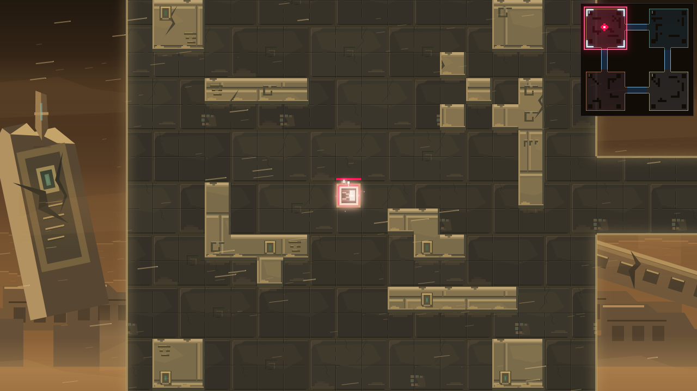
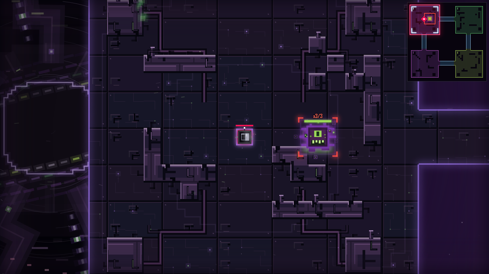

# Guardian world visuals (Venus, Sirius, the Singularity)

[Overview](README.md)

[Venus](VENUS.md), [Sirius](SIRIUS.md) and [The Singularity](SINGULARITY.md) use these world renderers as full challenges. Engine `createModeState` still supports a map preview through `trial.mapOnly` (with `noMobs` and `noBossSpawns`: no aliens, further bosses, meteors or events, no challenge mechanics or C skill, never counted as a clear, and the guardian bar showing the world name while the guardian is dead), but no world uses it now.

## Construction

`world-themes.ts` holds each `WorldTheme` (Venus, Sirius and the Singularity): room palette, minimap fill, backdrop, floor tile, cover tile and floor ambience. `worldTheme(state)` picks it by guardian and Sirius lighting. `RubyStarGame.tsx` uses it for the battlefield, backdrop, minimap, teleport picker and guardian-bar name. Drawing is read-only; ambience follows `gameTick`, while Sirius's cosmetic lighting transition advances in the animation loop.

Each world has its own materials, architecture and motion, tied to its guardian. Floors stay quiet, with sparse material details and restrained ambience clipped to floor tiles (`clipToFloor`). Cover keeps its full tile collision footprint; chips, dark tongues and background ruins are cosmetic. Drawing is deterministic for the supplied simulation tick and lighting blend, with balanced canvas save/restore calls.

## Venus: the Fallen Citadel

Buried monuments and weathered relics of an ancient fallen technological civilisation. Broad stone construction, eroded carvings and rare dormant aegis seals distinguish it from Jupiter's capacitors and Binary Star's station panels. Technology survives as traces in the ruins.
- **Rooms:** ALPHA antique gold `#c9ad72`, BETA oxidized teal `#78a99b`, DELTA terracotta `#b98264`, GAMMA pale limestone `#c5c2a0`. Borders, pads, minimap and teleport picker share these subdued mineral colours.
- **Cover:** large weathered sandstone courses crossing tile joins, broad mineral patches, worn crowns and plinths, chipped upper faces and sand along exposed lower edges. Sparse eroded inscriptions vary between interrupted stepped seals, worn horizontal bands and old glyph columns; only the rare carved bronze aegis seals retain a faint cyan remnant. No repeating machine cassettes, vents or circuit panels.
- **Floor:** worn limestone slabs span three tiles by two, with alternating courses offset by one tile. The sand-filled joints follow the gameplay grid, and inside each slab every tile is a scored paver: faint sand-filled seams along its top and left edges, broken where the stone has worn smooth, with a soft lit lip beside them (edges on a slab joint are left alone). About a fifth of tiles add a chipped corner holding a little sand, and some a hairline crack wandering in from an edge. Subdued mineral stains, chipped corners, occasional partly buried fractures and rare fragments of carved seals keep the material ancient and quiet. A few broken bronze/jade mosaic fragments show through sand at the slab edges. Low stepped sand banks partly bury slab joints and gather at the foot of ruin walls, without hiding the walking surface. Sparse tiny windblown grains fade as they drift. The paving remains darker than cover; no active conduits, shield lattice or machine-panel markings.
- **Backdrop:** a pale sun smothered in haze above two far stepped dune lines; a colossal fallen guardian's head lies half buried, its eye slit faintly cyan. Half-buried ruined terraces, a huge leaning fractured monument, dormant aegis totem fragments that still hover and bob with faintly flickering cores, and a toppled inscribed lintel sit beneath layered amber clouds. Worn stone and mostly dormant aegis carvings give the ruins their technological ancestry. Slow clouds and dust bury the lower silhouettes; no regular city towers.
- **Sand wind:** a visible blizzard-like flow of amber grains and long slanted streaks, in two depths with gently pulsing gusts. Faster brighter foreground sand crosses a denser layer of smaller grains; keep the scene readable without a fog blanket. It crosses scenery and actors before the minimap/HUD. Animation uses `gameTick` and freezes with play. It is entirely cosmetic: no damage, slowing, pushing, warnings or other gameplay effects.

## The Singularity: the Devourer's Maw

A vicious darkness swallowing a dying station. Monumental scale, broken silhouettes and inward motion give it the weight of the final boss's domain. Keep every solid form blocky, with stepped cuts, broad flat faces and selective violet/poison-green accents.
- **Rooms:** ALPHA violet `#a77bff`, BETA green `#7dff8a`, DELTA orchid `#e06bf0`, GAMMA lime `#d0ff6a`.
- **Cover:** joined black-violet monoliths with broad world-space plates, deep rectangular splits, pale fractured upper lips and void-bitten edges. Sparse inner violet/green fissures pulse beneath the shell. Broken obelisks rise from some exposed upper faces; short hooked black roots reach onto nearby floor. Now and then a wall pipe vents a puff of poison-green smoke that rises, drifts and fades. The collision footprint remains the full tile.
- **Floor:** dark, cleaved station plates, each 3×2 plate in its own dark tone with a slight violet, plum or green cast, faint bevels and corner rivets. Some plates carry faint etched circuit traces whose nodes pulse now and then; faint blocky rounded gravity ripples flow inward across each chamber. Sparse severed fittings and large branching, axis-aligned stress fractures. Restrained violet cores pulse inside deep black faults; occasional small green remnants travel along them. Sparse ash accelerates inward. Decoration stays dimmer than actors and avoids warning symbols or enclosed attack areas.
- **Backdrop:** dramatic and violent. A purple tint deepens with distance from the core: none until about the middle of the view, then growing stronger toward the far edge. Distant stars near the maw are lensed into arcs bending around it. A vast tilted accretion disc of violet, orchid and poison-green light spins around the abyss, blazing brighter on its approaching side, its far half passing behind the maw. The core is a blocky rounded square: concentric horizon layers with straight sides and broad stepped rounded corners, and a bright photon ring tracing the same stepped outline. The broken structural arms turn slowly and carry violet and green energy pulses racing inward; twin flickering jets lance from the poles; a planet is torn apart, its blocks spiralling into the maw. In the challenge the maw gulps each time one of the Maws on the floor opens (`syncSingularityGulp`; a Maw held by the god panel adds none); anywhere else it gulps every 45 seconds, the first time 45 seconds in: the core (horizon layers, slabs and photon ring) squeezes in by about a fifth over the first three seconds, then springs back slightly past its size and settles; the accretion disc tightens and flattens with it, the structural arms are drawn in toward the core, and the twin jets flare longer and wider; everything flowing inward (debris, starlight, the torn planet's stream, arm pulses and contracting plates) surges faster through a shared time warp that builds over the gulp and is kept afterwards, so nothing jumps; stars bend harder around the maw; streaks of light rush in from every edge and rings in the core's blocky shape race inward while the sky dims; the disc's spin surges, a violet shock ring fades in as it contracts across the sky, the screen edges darken, and a green glow in the core's blocky shape swells and fades over about three seconds. Every gulp envelope eases in and out, and the extra spin accumulates, so nothing snaps between cycles. Beneath it all sits a colossal stepped black abyss beside the platform, with interrupted uneven horizons, inward hanging slabs and black bites through the rim. Huge broken structural arms converge behind it. Severed hull blocks and stretched starlight accelerate inward; disconnected plates contract toward the unevenly breathing core. Moving structures rotate as whole solid shapes.
- **Atmosphere:** while a Maw sucks (`singularityOpenness`), the background behind the station (`drawSingularitySuction`, drawn under the floor and units, with no camera shake) is dragged into the backdrop black hole, everything centred on it as it drifts with the camera (`singularityHoleCentre`): a deep violet-to-black radial darkening, a huge vortex of spinning green, violet and pale rings shrinking around a black core, and over a hundred long speed lines with tumbling debris curving into it. Otherwise restrained dark pressure at the screen edges and sparse elongated remnants pulled toward the abyss, drawn over scenery and actors before the minimap/HUD. All motion follows the simulation tick. Fractures, obelisks, roots, pressure and debris are visual-only; no new hazards, collision or challenge mechanics.

The Singularity star-map icon is an irregular torn black aperture with a pale edge and four muted silver-grey fragments.

## Previews

`node scripts/preview-singularity.cjs docs/ruby-star/visual-reference` renders Venus, Sirius (both lighting states) and the Singularity in ALPHA and GAMMA from the real drawing code and checks that drawing never changes state.

 
