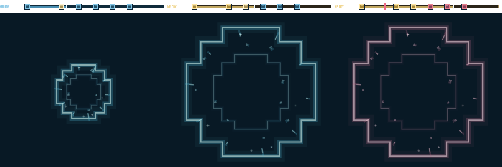
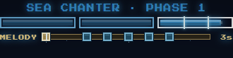

# Neptune challenge

[Overview](README.md) · [Gameplay](GAMEPLAY.md#modes-and-lobby)

Regular alien spawns use the [shared challenge pool](ENEMIES.md#shared-challenge-alien-pool): Ghost, Bomber and Lancer join after 60 seconds, with Shooter rare. The map’s themed enemies keep their own replacement chances and phase rules.

The Neptune Celestial Challenge (`/challenge/neptune`): a long fight against the Sea Chanter built around healing, HP swings and diving. Everything else about a challenge (stage 0, guardian-only boss, recharging celestial skill, win on defeat) is in [Gameplay](GAMEPLAY.md). Values live in `constants.ts` as `NEPTUNE_*`; guardian logic is `neptune.ts`, rhythm logic is `neptune-refrain.ts`, and clams use `neptune-clam.ts`. Shared Melody interactions live in `neptune-melody-targets.ts`; `engine.ts` supplies combat hooks. World art is in `neptune-art.ts`, with rhythm art in `neptune-refrain-art.ts`.

Neptune’s book button beside Begin Challenge opens [The Song That Found You](NEPTUNE-LORE.md), the tale of the Sea Chanter and Cael.

## Guardian: three phases

- 6750 HP in three phases of 2000, 2300 and 2450 HP, shown as a three-segment guardian bar (phase 3 on the left, phase 1 on the right) with the current phase's dive points marked. Phase 1 has three equal dive intervals of about 667 HP. The name line reads SEA CHANTER · PHASE n, plus · ECHOES left/total while she is under; the DIVE countdown appears below.
- Phases never reverse: damage cannot push her below the current phase, and healing cannot lift her above it. A phase ends only through its final dive. Clearing phase 3's final dive (at 0 HP) defeats her at once; there is no last hit.
- **Dive points** (fractions of the current phase): phase 1 at two-thirds, one-third and zero (about 1333, 667 and 0 remaining phase HP); phases 2 and 3 at 66/33/0%. When her HP reaches an armed point she dives at speed 12.84 and releases all her water echoes the moment she goes under, each at a random spot (at least 5 tiles from you) in a different room, so they must be hunted down: 3 per dive in every phase.
- **Echoes** (8 HP, swim speed 3.0, 25% faster in phase 3 via `NEPTUNE_CLONE_PHASE3_SPEED`) roam while distant and flee along navigable floor when you are within 7 tiles. Fleeing echoes move at 3× speed for 1 second, with a 10-second per-echo cooldown; Ocean’s Melody cancels an active burst when it taunts them. A normal Ocean’s Melody cast taunts living echoes within its 7-tile wave for 3 seconds, making them swim toward your current position through cover routes; further casts refresh it. They return to fleeing or roaming after the taunt. Taunted echoes brighten to mint water tones. [Echo palette](visual-reference/neptune-clone-taunt.png). Destroying an echo heals the player and Ruby for 20 HP each through normal capped healing and adds Chorus charge from actual recovery at the normalized rate described below; automatic dive cleanup grants no heal. They survive meteor strikes. Hitting one stops her ally-feeding heal for 4s. The DIVE bar uses the same blue as her HP bar and shows the time remaining, and the phase line shows the echo count. Destroy them all before the timer (20s, or 16s in phase 3) and she resurfaces at once and her HP snaps down to the dive point, cancelling any healing she gained. Each echo left when time runs out restores 10% of the phase. As she resurfaces, stepped teal waves and water streaks converge on her; rising healing crosses appear only if echoes restored her health. She [resurfaces to the shark charge cue](AUDIO.md#neptune) at the end of each dive. [Echo heal animation](visual-reference/neptune-clone-heal.png). Cleared phase-1 points stay finished even if she heals, so successful play has three dives. Failed phase-1 dives must be retried. In phases 2 and 3, a point re-arms once she heals above it, so dives can repeat. Clearing the 0% dive starts the next phase (full phase HP). Clearing phase 3's final dive wins the challenge immediately.
- God panel extras: Full Chorus (fills its charge bar), Next Dive (sets her HP to the next lower armed dive threshold), Start Song (starts or restarts a song while playing, including with a full charge or No Boss enabled; it never summons her or spends stored charge) and Phase 1/2/3 buttons that put her straight into that phase at full phase HP (summoning her if needed, cancelling any dive). Phase changes show a PHASE n banner.
- The Sea Chanter moves 7% faster in the Neptune challenge, including during dives. Her usual Sea Chanter rules still apply between dives (ally support healing, songs, healing while diving from hits on regular aliens). Fish, echoes and water balls never feed her.
- Her water attack (song wave and burst, not the water ball) deals +2 here: base wave 12, burst 17→7 over 6 tiles, before phase multipliers. Boss damage to you and Ruby is multiplied by 1.1 in phase 1 and 1.65 in phases 2–3: a wave deals 13.2 / 19.8, and the center burst deals 18.7 / 28.05. The burst also hits placed Ruby.
- **Phase 2+:** while surfaced she drops a water ball on your position every 6s: a 3s fuse, then a 4-tile water burst for 28 to you and Ruby. Destroying it first makes her take 3% of the phase instead. Pufferfish start spawning in phase 2 (see below).
- **Phase 3:** tides activate (see World rules). Her hits on you or Ruby do not restore her HP.

## Clams

One clam rests on an unoccupied floor tile in each chamber, away from teleport pads. All four start closed and reposition every minute of active play, choosing different tiles when space permits. Phase changes do not reset their positions or relocation timer. They are floor objects, not enemies, and do not block movement or take damage.

Ocean’s Melody opens closed clams within its cast range. Each stays open for 4 seconds, then closes and can be triggered again; notes cannot refresh an open clam. Opening launches a 0.6-second Melody wave to an 11-tile radius, using the same pearl-and-teal stepped pressure front as the map’s water effects. Its front passes through walls and hits each target once: enemies take 4 special damage once, and survivors—including the boss and echoes—are pushed 3 tiles and slowed to 55% movement speed for 3 seconds. Fish use their Melody break interaction and water balls take only their 0.85 Melody damage, without an extra damage hit. It also applies Melody’s normal interactions: blue/red fish break with their usual heal/hurt results, water balls lose 0.85 HP, echoes are taunted toward the player, and other closed clams relay a new wave. Clam notes do not score rhythm inputs or cause rhythm mistakes. Opening plays a normal harp note layered with the fish-hit miss harp; fish reached by the wave add that same hit cue. The shell uses a shaded pale fan, dark hinge, and mint pearl when open. [Clam models](visual-reference/neptune-clam.png) · [Battlefield wave](visual-reference/neptune-clam-wave.png). Regenerate these with `node scripts/preview-neptune.cjs docs/ruby-star/visual-reference --clams-only`.

Phase 3 adds five corrupted clams: one in each chamber and one in a random hallway, alongside the four friendly clams. Their dark rose shells and pink pearls distinguish them. Entering the phase adds them without moving the friendly set; every minute, both friendly and corrupted clams choose new tiles. Corrupted and friendly clams never share a tile.

Melody opens a corrupted clam for 5 seconds; its 10-tile wave affects the player instead of enemies: 5 damage once, a 5-tile push at 1.6× normal knockback speed and 30% movement slow for 1 second. Damage respects shields and protection; control immunity prevents its push and slow. The hostile wave passes through walls, leaves Ruby unharmed, does not break fish or balls, taunt Echoes, or relay other clams. The four normal clams keep their friendly Melody waves. [Corrupted clam](visual-reference/neptune-corrupted-clam.png) · [Distorted wave](visual-reference/neptune-corrupted-clam-wave.png). Its wave adds a dark violet wake, broken inner pressure bands and sharp rose refraction shards, while retaining the same hit radius.

## Ocean’s Melody: surfaced rhythm

The first natural refrain starts 6 seconds after the guardian appears, while she is surfaced. Uninterrupted song starts remain 18 seconds apart; the pause absorbs the shorter round and any wait before answering. The pool contains 23 authored two-bar 4/4 phrases at 240 BPM, with 4–10 notes each. Phase 1 offers six simple phrases, phase 2 adds eight and phase 3 adds nine; later phases can also select earlier phrases. Every bar sums to four beats using whole (4), dotted half (3), half (2), dotted quarter (1½), quarter (1) and eighth (½) note values; the timings follow those lengths. Each phrase has an automatic pentatonic harp melody, identical in the example and correct responses. Pitch is never shown or scored. The first round uses a simple phrase, and later rounds avoid an immediate repeat.

Both halves read **MELODY**: blue for the example and warm gold for your answer. Attack and effects sounds reduce to 50% volume 1.5 seconds before the example begins; music is unchanged, and free skill notes stay quiet. The example starts on its first note without a count-in, with the same screen-edge water overlay used after the answer. On your answer, the bar stays at the beginning until the first press of your configured primal-skill key, which starts the bar and plays its first note. A separate 5-second deadline starts when the answer appears, even while the bar waits. The played phrase lasts 2 seconds, so waiting more than three seconds leaves less time to finish. At the deadline, all remaining notes become misses. Each note missed during progress plays the same softer lower harp cue as a wrong-time press. A small countdown beside the bar shows the remaining deadline. From the first reply press until resolution or cancellation, enemies, their attack clocks, hostile shots, sharks, Sea Chanter wave attacks, water-ball fuses and meteor countdowns advance at one-eighth speed. The player, their attacks, the rhythm bar and reply deadline stay at normal speed; the example and waiting period do not slow enemies. Normal enemy speed returns immediately when the song ends, before the completion overlay fades. The pause after a round is normally 14 seconds, or shorter after a delayed start, preserving the 18-second cycle.

Tapping the configured primal-skill control plays Melody and scores note starts; holding it for 0.2 seconds while Chorus is ready opens the room picker. The timing window is at most ±10 gameplay ticks, tightened to stay below half the nearest note spacing (±7 ticks for adjacent quarter notes, ±3 for eighth notes at this tempo). Held-key repeats do not count as new presses. The bar, deadline and judgement share the fixed gameplay clock. Notes played during the blue example are free practice.

The song accrues up to 20% of current phase HP as **pending** healing across both halves. The pale translucent blue fill beyond real HP shows the maximum remaining possible heal from the start, then shrinks as correct notes cancel it. It is a preview only: it cannot trigger a dive, absorb damage or restore health before settlement. At the end of the answer, each correct note cancels an equal share of the heal; each wrong-time or duplicate press counts as another miss, capped at the full budget.

At resolution, the player and Ruby each recover up to 20 HP, multiplied by the credited hit fraction after wrong-time penalties: 50% accuracy restores 10 HP each, and 100% restores 20 each, capped by their maximum HP. A perfect answer with no extra presses cancels all pending boss healing and deals 5% of the current phase’s HP to the surfaced boss through normal skill damage. The healing feeds Ocean’s Chorus through the normalized recovery rates below; God-panel practice grants no player/Ruby recovery or boss damage, regardless of score.

Missed nodes turn rose, correct nodes gold, and extra mistakes reduce the final cancellation. Each wrong-time or duplicate answer press leaves a thin red rectangle at that timestamp on the song bar; up to 64 recent markers remain until the song ends. Misses trigger a brief rose water overlay at the screen edges and a slight 6-tick, 1.5-strength camera shake; completing a song brings in blue water crests, mint for a perfect answer. There is no miss or healing-result text. The portion attributable to expired notes and wrong-time presses is shown in rose-red within the pending HP extension; every extra press adds a red share, capped by the total preview, without adding a second heal. [Mistake preview](visual-reference/neptune-mistake-heal.png). The final remaining heal is applied once, capped at the current phase. Other existing healing remains independent. Tuning and phrase state live in `neptune-refrain.ts`; the score and world note pulses share `neptune-refrain-art.ts`.

Natural combat songs run only while surfaced. Entering a dive, jumping phases or removing the boss cancels the unfinished combat song without applying its pending heal; the next automatic song uses the 14-second gap. Pausing freezes the song clock, notes and effects. Old saves initialize missing song fields on their next surfaced update. God Start Song also works as a standalone practice song with no guardian, during a dive or pending Chorus strike, or with No Boss enabled: the demo, answer, note input and completion effects run without summoning her or applying real healing.

Full Ocean’s Chorus charge prevents the next song from starting; a pending Chorus strike also postpones automatic songs. If healing (including a God fill) reaches full charge during either half, the meter holds at 119/120 with a pending-full flag; tapping still plays Melody, while holding the primal skill for 0.2 seconds releases the charge and opens the room picker. Chorus can be selected during a song or dive; the picker pauses play, then the current song or dive resumes after choosing a chamber. A dive cancellation also releases held full charge. Its room strike and ordinary meteors each deal 10% of current phase HP.

## Recovery and Chorus charge

Neptune’s Tide (F) restores up to 65 HP each to the player and Ruby on this map, with its shared 20-second recharge and 8-tile, 3-tile knockback. Other maps retain the normal celestial-skill healing. All recovery respects maximum HP and player healing restrictions.

The extra recovery is weighted before the normal 0.93 charge-per-HP conversion. A complete 20-HP song reply credits at most 15 effective HP per recipient (scale 0.75); a 20-HP Echo kill credits 5 per recipient (scale 0.25); Neptune’s Tide credits 40 of its 65 HP per recipient (scale 40/65). Each scales with actual recovery, so overhealing gives no charge.

Blue fish use a 13/60 recovery scale in phases 1–2 and 13/80 in phase 3 across both recipients. A fully effective blue fish restores 24 combined HP and gives 4.836 charge in phases 1–2 or 3.627 in phase 3. At one spawn every 1.5 seconds, ordinary 75%-blue spawning budgets 2.418 charge per second in phases 1–2. Phase 3 remains capped at that rate even when every refill uses its extra blue-only slots; mixed refills, travel, cap saturation and overhealing can lower realized income. This offsets the extra fish without accelerating Chorus; other healing retains its normalized rates.

## Rule sheet

The rule-sheet cards briefly describe what each thing does. The Primal Skill card shows both Melody and Chorus, with a separate Chorus card explaining healing charge. The Melody illustration uses one wide, unlabeled timing bar. [Melody card](visual-reference/neptune-melody-card.png). The warm-gold introduction states the goal: destroy her echoes and answer her melody. The Clam card describes opening it with Melody and the wave’s damage, knockback and slow. The phase-3 Tides card uses the two-chamber current illustration and the short description “Currents push you along.” [Tides card](visual-reference/neptune-tides-card.png). Cards are grouped under General Rules & Skills, Enemies, Phase 2+ (pufferfish and water balls) and Phase 3 (tides and corrupted clams). The three-phase illustration reads its phase-1 dive marks from the same thresholds as the guardian HUD. [Phase markers](visual-reference/neptune-guide-phases.png).

## World rules

- No space events. Meteors still fall and deal 10% of the phase to her.
- God-panel No Mobs also suppresses sharks and jellyfish, including jellyfish scheduled during a dive.
- **Ocean’s Melody / Ocean’s Chorus** (code: `useOceanMelody`, `openSkyLaser`, `chooseSkyLaser`, `neptuneStrike`): the primal skill has no cast cooldown. Tapping the configured primal-skill control plays a note and a short blocky cyan water pulse; within 7 tiles it breaks blue/red fish, deals 0.85 HP to water balls, taunts echoes and opens closed clams. The cast itself does not consume charge or directly heal, although fish and completed song replies can heal as described above. A healing bar beside energy holds up to 120 charge. Ordinary healing grants 0.93 charge per actual HP restored (`NEPTUNE_HEAL_CHARGE_RATE`); blue fish, song replies, Echo kills and Neptune’s Tide use the normalized rates in Recovery and Chorus charge. When full, hold the primal-skill control for 0.2 seconds to open the minimap room picker, including during a song or dive; play pauses until a chamber is chosen, then the song or dive resumes. The chosen room blinks pale cyan on the minimap (like a meteor warning) and is struck 3s later like a meteor: regular aliens, echoes and water balls there are destroyed; fish and clams remain (a ball destroyed this way still hurts her). She takes 10% of phase HP in every phase, and you and Ruby take meteor damage if inside.
- **Fish** (1 HP, cap 16 in phases 1–2 and 20 in phase 3; one spawns every 1.5s while below cap. The first 16 slots use 75% blue / 25% red; phase 3’s four additional slots always spawn blue, preserving existing red fish) only roam: they never chase or attack. Only Melody breaks them: the player’s 7-tile cast or a normal clam’s 11-tile wave. Blue fish heal you and Ruby for 12 HP each while she is surfaced, or heal her 3% of the phase while diving instead. Red fish cost you 7 HP. Normal attacks, celestial skills, meteors, Ocean’s Chorus and enemy attacks cannot break them. Bullets never auto-aim at fish. Fish give no score, energy or kill healing, never block alien spawns and never count as nearby enemies for manual healing.
- **Jellyfish** (2 HP, slow, melee 6 to you / 3.5 to Ruby): one drifts in every 20–30s, at least 6 tiles from you, with at most two around; each dive also has a 50% chance to bring one 4s after she goes under, even at that cap. Killing one during a dive marks the echo nearest to you for 4s, with a pink light column on screen and a pink blink on the minimap.
- **Shark:** every 7.5–12.5s a lane through your chamber (your row or column) flashes red with chevrons for 1.2s. A shark then charges in from one wall at half a tile per tick and leaves through the other. It hits you for 22 and throws you 3 tiles sideways off the lane, hits placed Ruby for 22, and bites her for 5% of the phase if she is in the lane. It never roams. Each normal charge has a 35% / 43% / 50% chance in phases 1 / 2 / 3 (`NEPTUNE_SHARK_FOLLOWUP_CHANCE`) to announce a second shark as it launches. The follow-up marks the player’s current chamber on the perpendicular axis, warns for 1 second, then charges (`NEPTUNE_SHARK_FOLLOWUP_DELAY`); both sharks update and draw independently. A follow-up cannot spawn another follow-up, except that in phase 3 a shark has a 10% chance (`NEPTUNE_SHARK_TRIPLE_CHANCE`) to be a triple: its follow-up always comes, and as that follow-up launches a third shark is announced across its lane and charges 1 second later. Normal shark scheduling waits until all of them are gone. [Follow-up shark warning](visual-reference/neptune-shark-followup.png).
- **Pufferfish** (phase 2+; 7 HP, speed 2.5, replaces 28% of the remaining alien spawns from phase 2 on): chases you; when close it stops and swells for 0.5s (bristling, flashing), then bursts. You and placed Ruby take 8 within 3.5 tiles and you are knocked 2 tiles away from it. 2.5s before it can puff again. It also bursts the same way when it dies (a small water splash), with the same damage, range and knockback.
- **Stingers** (fish-like alien, 6 HP, speed 1.3, replaces 35% of alien spawns) bite for 5 (3.5 to Ruby) and poison you for 3 damage per second over 4s.
- **Tides:** phase 3 only; two chambers always have currents, with their chambers and directions rerolled every 15 seconds (`NEPTUNE_TIDE_ROTATE`). Phases 1 and 2 have no currents. Moving with it is 1.4× faster, against it 0.7×, and the player is pushed one tile along it every 50 ticks unless swimming with the flow, like the black hole.

## Look

Water echoes are see-through copies of her silhouette at 75% scale (square shell, stepped fan fins, crest, fluke and pearl eyes) in flat water tones, with one light band sweeping down and no face details. Ocean palette: blue-teal room colors, deep blue floor with drifting light caustics, sandy specks, interior cover drawn as joined blue-teal reef limestone (`drawNeptuneRock`): broad eroded shelves and occasional fractures continue across tile joins. Exposed upper faces carry pale sediment, side faces use restrained natural highlights, and lower/right edges remain dark. Opaque shaded edges replace the cyan frame and wide per-tile crevices, avoiding doubled bright corner pixels. Sparse barnacles and muted pink/orange/violet coral keep the reef identity.

Stone coral varies in scale and branch height, with thick rectangular branches and broad two-tone shading, and no tiny white tip specks. Some grows on the wall face; some roots on exposed upper edges and rises above the stone.

Kelp grows as a restrained scattering of rooted clusters on wall faces and exposed upper edges: three stable variants mix thin reeds, fuller broad-leaf clusters and taller fronds. Occasional tall clusters reach 72–96px (about two tiles) and may extend beyond their root tile. They differ in stem thickness, leaf size, height and two- versus three-frond grouping, while retaining three chunky alternating stepped blades each and simple flat colours with no leaf veins or miniature detail. Colour varies independently of size between deep forest green, muted jade and fresh green, each using a darker stem and lighter blades. Each whole frond tilts gently as one solid shape; kelp explicitly draws at full opacity regardless of the preceding particle pass.

Original floor tiles, grid, glowing tile caustics, sandy specks and plentiful square bubbles remain. Each chamber contains just one settled shell, one starfish and one broken coral sprig, placed deterministically on open floor and spaced apart. Their 21–34px silhouettes use chunky axis-aligned rectangles and broad flat shading in muted grey/sand/rose tones. The shell is a wide stepped scallop fan with two bold grooves and a narrow hinge; the starfish has five clearly separated blocky arms and slightly stronger contrast. There are no fine rib lines, diagonal star points, glow, motion or pickup treatment. An additional restrained connected water-wave pattern moves across the floor, clipped away from cover; sparse marine snow drifts through it. Water ambience and kelp live in `neptune-art.ts`.

A water ball bursts as a water effect (not the bomb blast): a pale wash over the hit area, a stepped crest ring sweeping out to the edge with a deeper blue ring behind, a short splash column and eight arcing 12px droplets. The minimap and teleport/laser pickers use the same ocean room colors, and tide rooms show a faint blue wash with pale chevrons drifting in the current's direction.

The open-ocean backdrop has a depth gradient, swaying light shafts, rippling surface caustics, a distant manta ray, reef silhouettes with bioluminescent tips and kelp, bubble columns, fish schools, pink/cyan jellyfish and marine snow. Layers move with their own parallax.

Current source-rendered references: [battlefield](visual-reference/neptune.png), [Gamma](visual-reference/neptune-gamma.png), [joined reef cover](visual-reference/neptune-reef-cover.png), and [kelp at three animation ages](visual-reference/neptune-kelp.png). Regenerate with `node scripts/preview-neptune.cjs docs/ruby-star/visual-reference`; the preview checks that drawing preserves game state.

The Ocean’s Chorus target room breathes pale cyan, with a narrowing targeting column during its countdown. Its impact uses a broad column, narrowing core, square water shockwaves and arena-wide pressure fronts. Cool pearl/mint water tones, travelling refractions within the beam and a subdued room flash keep its silhouette readable. The blast releases 48 arcing pearl sprays with 2–5px shaded water plates and intermittent 6px glints; these cosmetic sprays can pass the room edge. Inside the room, 64 translucent 4–7px falling droplets and 24 faint 6–8px pearl crosses add visible sparkle. Particle opacity stays low: spray faces peak below 24%, falling droplets below 24%, and glint cores below 30%, keeping the main water blast dominant. The first two arena-wide pressure fronts carry 280 scattered particles: small hollow 10–12px stepped bubbles with faint blue interiors, clear pale rims at 55% opacity and brighter highlights, plus crisp 9–15px pearl glitter with staggered white flashes. They travel with the wave across room borders; the wave uses bubbles and glitter instead of long line fragments or spray trails. Damage stays confined to the chosen room. Reference: [Ocean’s Chorus stages](visual-reference/neptune-trident-impact.png).

Between surfaced songs, a blue NEXT SONG countdown bar uses the shared guardian countdown style, including the quiet warning lead-in. It gives way to the Melody score on the first example note, and is hidden during dives, full Chorus charge and pending Chorus strikes. Ocean’s Melody uses the same left-label layout as the other guardian countdown bars. Both halves read MELODY: blue for the example, warm gold for the answer. Larger square timing nodes have clean shaded fills, a subtle top highlight and a bold 2px outer border; correct notes turn gold and missed notes rose. Pitch is never displayed. The pending-heal preview uses the real HP fill’s bounds and shading, with pale translucent blue and a rose-red share for mistakes. There are no miss or healing-result text messages.

Normal casts share the trident explosion’s stepped pressure-front silhouette at a smaller scale: a slightly thicker pale expanding edge (10px blue body, 3px pale core), soft blue wake, a faint trailing echo and ten restrained 10–20px refractions. Eighteen softer pearl-white glints shimmer at staggered moments along the moving water, using crisp 5–8px crosses with 3px square cores. Player Melody casts also carry ten low-opacity 4–7px shaded water droplets (example notes use five), with pale faces and short reflected highlights. The glints, droplets and refractions stay translucent beneath the brighter wave. The expanding front reaches seven tiles and fades over 0.6 seconds. It is cosmetic: the player’s Melody interactions resolve immediately on casting, while clam waves apply interactions as their fronts travel. Song completion lasts 3 seconds: three pale pressure fronts cross the view and flow into large flat translucent tidal-glass sheets at the edges, without shaded faces or raised rims, with broad water reflections, refractions, foam glints and rising pearl light. Misses use a shorter rose edge response. The center stays readable. [Completion overlay](visual-reference/neptune-melody-overlay.png).
