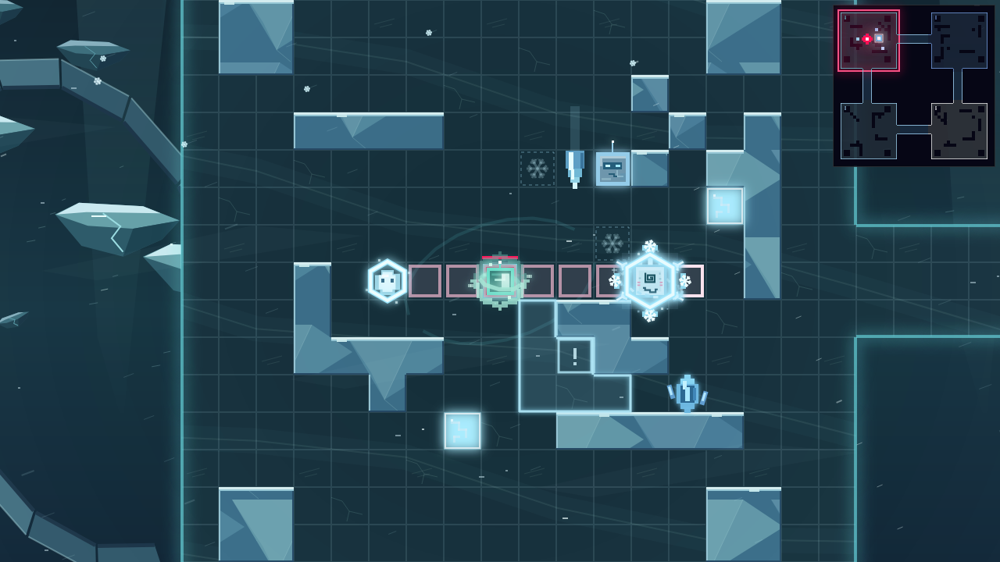

# Saturn

[Overview](README.md)

Saturn is a playable Celestial Challenge at `/challenge/saturn`. Frost Warden has 3,600 HP in three equal 1,200-HP phases. All three phases use the same shield, blizzard and weak-window loop. Standard four-chamber movement, carrying Ruby, teleporting and meteors remain. Random space events and ordinary automatic alien spawns are replaced by this encounter's own population. Desktop unlock and first-clear Diamond rewards use the normal challenge rules.

## Blizzard and shields

- While the Warden's barrier is up, blizzard covers the entire map, including hallways. Every 30 seconds it advances from level 1 to 2, then 3; level 3 is the cap.
- Each second you and placed Ruby take 2 / 4 / 7 damage at levels 1 / 2 / 3. Regular aliens instead take 0.5 / 1 / 1.5 damage per second, so their smaller HP pools survive long enough to fight and steal from. Damage to player, placed Ruby and regular aliens is multiplied by 1.5 inside the Warden's current chamber; other rooms and hallways keep the base rate. The Warden is immune. Ordinary damage reductions apply first. Shields absorb blizzard damage at half the usual shield cost; any unabsorbed damage reaches HP at full strength. Blizzard alien deaths give environmental rewards, without normal kill healing or energy.
- Having any absorb shield prevents the normal global blizzard slow outside the Warden's chamber, but does not prevent shield depletion. Inside his current chamber, a shielded player still has a mild 15% movement and attack-progression slow; this ends during the weak window. An unshielded player has the standard Warden movement slow and half attack progression anywhere on the map. Unshielded aliens run their movement and attack AI at half cadence. Carried Ruby retains its normal immunity to direct damage.
- Player and Ruby begin with 20 shield each. Each combat kill of a non-boss alien grants 10 shield to both player and Ruby, in addition to existing type rewards. Blizzard and meteor deaths do not grant this bonus. All shield gains **add** in Saturn, including Armored/Shielder kill rewards and Saturn Guard. They share one pool per character, have no expiry and no cap here. Ordinary modes keep their existing refill/cap rules.
- Shield shards join the normal timed resource pool in Saturn with equal health/energy/shield chances, keeping the existing roughly 9.1-second spawn interval and five-pickup map cap. Collecting one adds 40 shield to both player and Ruby, with the usual shield reward effects and pickup sound. Other modes retain health/energy pickups only.
- Player attacks (including celestial attacks) restore player shield equal to 100% of the ice shield HP actually removed from a non-boss enemy. HP damage and overkill give nothing, Ruby receives no share, and enemy/weather/meteor/reflection/summon damage does not trigger this reward. Snowball retains its full shield theft and shared Ruby gain; boss barriers remain excluded.
- Saturn Guard (F) adds 40 shield to each character at challenge stage 0, recharging in 20 seconds. Its existing suit, cast and shield artwork are preserved. Shields protect Ruby while yours can also fuel Snowball.
- The Warden periodically shoots up to three living aliens across the map, prioritizing the lowest shield pools. Each target gains 20 shield every five seconds; grants add to existing shields.

## Snowball (hold the map-skill input)

- Hold the configured map-skill input (Middle Click by default; keyboard bindings can be added in controls) to transform and charge while walking. The range grows from 2 to **8 tiles maximum** over 0.75 seconds; holding longer adds no range. Movement input walks and changes facing while charging. Releasing aligns the roll to the nearest legal tile endpoint. Floor-tile previews show the exact path and stop at walls.
- Release to roll straight ahead at 18 pixels per tick. The roll stops at cover, range, freezing or the Warden. Contact with the Warden stops at his near edge and settles on the approach-side floor tile, never through his body, whether shielded or exposed. Held movement is cleared on that impact. Reaching cover plays the same impact recording as hitting an enemy; reaching the range cap does not. Attacking with laser, bullet, wave or bomb cancels a charge/roll first. The next attack can fire normally. Cooldown is two seconds from release after a hit. If the roll ends without hitting any enemy (including wall stops, freezing or attack cancellation), cooldown resets immediately with the existing ready cue. A release directly into adjacent cover also resets it; boss contact counts as a hit even if no barrier damage is dealt. Completing recharge plays the existing map-skill ready cue once. Keyboard and mouse hold sources release independently; losing focus, rules, teleporting and restart cancel held charging.
- Each alien along the path is hit once: transfer its entire ice shield to both your pool and Ruby's pool, then deal 2 damage. Stealing a positive shield pool stuns that enemy for 1.2 seconds and cancels its current wind-up or rush; an unshielded hit does not stun. It reuses the existing stun timer and three-square marker. Snowball kills of Armored also share its usual shield reward with Ruby. Substeps prevent fast movement skipping enemies, ice or walls. Active rolls ignore knockback while still taking damage; charging can be interrupted. The rolling form keeps the existing Saturn shield artwork and shows carried Ruby.
- The Warden starts each loop with a 5,000-point special barrier. While it remains, all ordinary damage sources are blocked. Ramming calculates exponentially scaling barrier damage from your full shield pool, then refunds 10% of that pool to the player only (including hits while the Warden is exposed; Perma Shield remains unchanged): `100 × (2^(shield / 100) − 1)`. For example, 50 / 100 / 150 / 200 shield deals about 41 / 100 / 183 / 300 barrier damage. A fresh barrier needs about 568 shield to break in one ram. Small pools are less efficient; building a large pool gives progressively more damage per shield point. The boss's barrier cannot be stolen or absorbed; the player receives only the 10% refund, and Ruby receives no shield from this hit. Zero shield cannot crack it. Any actual barrier reduction immediately resets blizzard to level 1 and restarts its escalation timer.
- Every Snowball hit that damages the barrier heals player and Ruby proportionally: `actual barrier damage / 5,000 × 20%` of each character's maximum HP. Damaging a full barrier across one or several hits therefore restores 20% total before the break bonus. Overkill and hits against an exposed boss add no proportional healing. Healing includes carried Ruby and caps at full HP.
- Breaking the barrier makes the Warden lose 20% of one phase's HP (240), heals player and Ruby for an additional 20% of their respective maximum HP (capped at full health, including carried Ruby), stops the blizzard and opens an eight-second weak window. Ordinary attacks deal full damage during that window. The barrier then returns at 5,000 and the storm restarts at level 1. The self-damage uses a fixed phase share across all three phases. Only the final guardian defeat wins. Snowball impacts on ordinary shields give a brief light screen shake. Every Snowball hit on the Warden gives an 18-tick shake at amplitude 10, including exposed hits; breaking the Warden's barrier gives a heavy 30-tick shake at amplitude 16 using the existing camera effect. A 1.1-second screen-wide ice shatter adds one brief cold flash, separating translucent angular ice faces and tumbling rectangular fragments. It is drawn below the minimap/HUD, pauses with simulation time and clears on restart or encounter cleanup.

## Frozen floor and aliens

Thirty-two frozen tiles across the map plus sixteen extra in the Warden's current chamber reposition every six seconds, with a one-second warning before the new layout activates. They keep the existing glowing frozen-tile artwork and 1.5-second freeze, which blocks movement, laser, bullets, charged wave, bombs and celestial skill casts until thawing. Contact halves player shield and cancels Snowball. Ruby's shield remains. Triggered ice melts so standing still cannot cause an endless freeze loop. The Warden teleports to a different random chamber every 30 seconds using the usual relocation sound. Teleporting immediately warns a new ice layout with the sixteen extra tiles in his destination chamber. The relocation timer pauses during his weak window and with gameplay; global blizzard and shield casts retain Saturn's rules.

The encounter spawns one alien every 3.5 seconds, up to 22 total units including the guardian: 25% Snowbowl, 20% Frosticle, 20% Ice Cub, 20% Armored and 15% Normal. Only Snowbowls start with ice shield (24). All other aliens are born unshielded; the Warden can shield them later. No Boss leaves normal spawning and alien attacks running independently; No Mobs suppresses the alien population. Wave knockback interrupts their committed attacks. All three Saturn aliens use the normal targeting preference: attack placed Ruby when she is more than two tiles closer than the player; otherwise prefer the player. Carried Ruby cannot be targeted. Snowbowl can hit either character along its committed rush.

| Alien | Behavior |
| --- | --- |
| Snowbowl (`frost_raider`, 18 HP) | Approaches the player or placed Ruby. When aligned within eight tiles, marks a straight lane and charges for 0.8 seconds, then rolls quickly along that direction. Contact steals the struck character's entire shield into its own shield before a 10-damage hit. Can be dodged sideways. Each rush steals once; cover stops it. |
| Frosticle (`ice_caller`, 12 HP) | Stationary crystal caster with an eight-tile range and an eight-second attack interval. Locks a marker onto the target's current floor tile. A Weaver-style connected floor tint, exposed boundary and **!** warn for two seconds before a 0.4-second accelerating icicle drop. The marker does not track movement. Impact deals 12 damage to player or placed Ruby in the marked tile, bursts into ice shards and freezes walkable tiles in the surrounding 3×3 area for 1.5 seconds. Patches reuse the standard frozen-tile appearance and fade during their last half-second. Unshielded blizzard slow lengthens the caster's attack cadence. |
| Ice Cub (`rime_brute`, 30 HP) | Approaches at 3.2 pixels/tick before blizzard slow. Within 1.8 tiles, strikes immediately for 12 damage with a three-second attack cooldown; no wind-up or charge aura. It can hit player or placed Ruby; Ruby stays fixed. Its two-tile wall-aware player shove uses the same `shovePlayerFromEnemy` helper as Emberling and Ragecap. Shields and Invincible prevent HP damage but do not prevent the shove. Keep out of reach to avoid it; the shove can push the player onto ice. |

## Visuals and interface

The frozen ring station uses distinct cyan Alpha, glacier-blue Beta, light-blue Delta and white Gamma chamber borders, with matching floor accents, teleport pads and teleport-selection colors. It keeps the existing floor inlays and parallax ring/floe backdrop. Joined cover is dense blue glacial crystal with broad continuous faces and restrained snow on exposed tops. Avoid repeated pipes, mechanical panels or translucent tile-sized sheets. Walls retain their real collision footprint.

Level 1 has light cold tint and sparse snow. Level 2 increases snow density, wind speed, blue tint and sweeping gusts. Level 3 adds heavy foreground snowfall, broad fast gusts and stronger icy-blue edge pressure, leaving enemies and warnings readable. Weather uses simulation time, stops in the weak window and never mutates state while drawing. All new snowflakes use solid rectangular branches and square ends.

Frozen-tile warning snowflakes use the shared chunky shape at about 25% opacity; Frosticle attack warnings use the Weaver's **!** instead. Snowbowl rush warnings share the player's tile-preview drawing, in rose to mark danger, both with four-pixel borders. The three aliens have distinct non-humanoid silhouettes: the Snowbowl is a snowball with two small eyes and no blue cheek patches, the Frosticle a blue crystal with detached shards, and the Ice Cub a square ice body with pale frost edges, subtle right-angle ice seams, two narrow blue eye slits, a small cracked mouth and one antenna. Its square rim and inset reference the ordinary alien, while its face and ice material remain distinct. Their proportions, clear inset/core construction and restrained animation follow the Sun and Neptune aliens. The Frosticle gathers its detached shards and brightens its core while casting. Ice Cub lunges on contact and produces a local square shove burst; neither attack uses the shared generic laser streak.

All non-boss unit HP bars use the same shared Endless style, above the unit and visible only after damage; see [Enemies](ENEMIES.md).

The guardian bar has three HP segments and a smaller barrier meter. A **single three-branch snowflake** sits to its right: one bright branch at level 1, two at level 2, three at level 3; unused branches are faint and all dim while stopped. Your shield counter sits beside energy; Ruby's sits beside Ruby HP. Snowball uses the same icon-only, 42px cooldown HUD format as the other map skills. Rules use the shared animated picture-card format and the existing F card. Stack Shields shows player and Ruby; Break the Barrier shows a Snowball collision with the Warden; Weak Window shows the actual exposed Warden. Only Snowbowl wears a shield in the alien cards.

Blizzard hits use the supplied `blizzard-damage.mp3` only when player or Ruby HP actually drops, once per pulse. Shield-only damage and fully prevented hits are silent. The cue replaces their ordinary hit sounds on those pulses. A successful Snowball hold begins with the existing bomb-placement sound, once; contact plays the supplied `snowball-hit.mp3` once per enemy struck. Warden impacts use gain 1 instead of 0.7 and playback rate 1.25 with pitch preservation disabled. Other hits retain their normal audio. Snowball is a simple block-built snow form with a motion trail and no spinning snowflake decoration.

God controls match existing challenge buttons: Phase 1/2/3, Snowball Ready beside Skill Ready, Shield +40, Perma Shield, Remove Shield (both player and Ruby), Blizzard +1/−1 and Expose. Perma Shield gives both characters at least 40 shield and absorbs all incoming damage without depletion. Theft, freezing and ramming cannot spend it; it persists through restart. Remove Shield disables the mode and clears both pools. It is a development control; normal challenge shields retain their ordinary costs. Level controls clamp at 1 and 3. Standard No Mobs, No Boss, restart, pause and victory cleanup remain available.

Implementation: `saturn.ts`, `saturn-art.ts`, `SaturnGuide.tsx`, `SnowballStatus.tsx`, `BlizzardStatus.tsx`, `ShieldAmount.tsx`; shared existing shields are in `ice-shield-art.ts`. Verification: `node --test tests/saturn.test.cjs`, `node scripts/check-ruby-saturn.cjs <output-directory>` and `node scripts/preview-saturn.cjs docs/ruby-star/visual-reference`.

[Level 2](visual-reference/saturn-blizzard-2.png), [level 3](visual-reference/saturn-blizzard-3.png), [Snowball](visual-reference/saturn-snowball.png), [weak window](visual-reference/saturn-weak.png), [barrier shatter](visual-reference/saturn-shatter-burst.png), [alien models](visual-reference/saturn-enemies.png).
