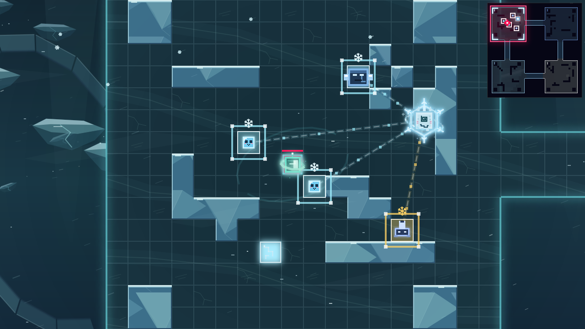
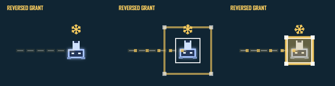

# Saturn

[Overview](README.md) · [Gameplay](GAMEPLAY.md#modes-and-lobby)

Normal spawn slots draw from the [shared challenge alien pool](ENEMIES.md#shared-challenge-alien-pool) like the other maps: Armored, Healer, Runner and Charger join on the opening schedule, then Ghost, Bomber and Lancer after 60 seconds, with rare Shooters. The map’s own enemies retain their existing spawn rules.

`/challenge/saturn` is a fight against the Frost Warden in which you rarely hit her. **Her frost shields are her life:** she gives large frost shields to her aliens. Breaking or taking her frost shields damages her. She calls the frost shield that is still out back to heal, and tears at herself when none is left. She has three phases of 1,200 HP (3,600 total); phase 2 adds Frost Bloom, frost-shielded empowered aliens and occasional reversed grants, and phase 3 adds Frost Anchors and freezing grant and recall lines. Only the final defeat wins. Tuning is `SATURN` in `saturn.ts`; art is `saturn-art.ts`; the rule sheet is `SaturnGuide.tsx`; the C icon is `TimeStopStatus.tsx`.

Regular alien spawns, space events and the ordinary Warden chamber slow are off. Meteors still fall and take 10% of a phase from her, even through her own frost shield (it neither blocks nor absorbs the hit). Unlike elsewhere, a meteor here breaks her frost shield on shielded aliens in its chamber (costing her like any broken frost shield, without creating a pickup), but they survive; unshielded aliens are destroyed as usual. She still teleports into your chamber every 30 seconds.

Saturn’s book button beside Begin Challenge opens [Leave the Light On](SATURN-LORE.md), the story of the Frost Warden, her daughter Eda and the station’s landing lamp.

## Frost shields

- **Direct hits:** her body takes only 10% of your weapon and skill damage (`directDamage`).
- **Shatter:** frost shield you break on her aliens with your attacks costs her 20% of its amount (`shatterShare`). Frost shield broken by other sources does not.
- **Grants:** every 6.5 seconds (`grantInterval`) she gives 45 frost shield (`grantAmount`) to each of up to three marked aliens, a Glacier Hulk first and double (90). The targets for the next grant are marked as soon as a grant lands, so you have the whole cycle to find them. A snowflake hangs over each, a dotted cyan line joins it to her, and for the last 1.5 seconds a cyan square closes onto it and lands on its outline as the frost shield arrives. The minimap marks targets with cyan brackets that blink in the last 1.5 seconds, and every alien holding her frost shield with a bold violet diamond outline over its dot that flashes white during a recall warning. If fewer than three aliens are around, empty slots fill as new ones arrive.
- **Take it:** a marked target that dies before the grant keeps its slot (a Hulk's still double), and its frost shield comes to you instead, but only two-thirds of it as shield (30, or 60 from a Hulk; `killShieldShare`). Taking a dead marked target's grant costs her 20% of its original amount (`absorbShare`).
- **Recall:** every 19.5 seconds (`recallInterval`), always midway between two grants, 3.25 seconds from each (the first recall waits an extra 3.25 seconds, `recallOffset`), she pulls back every point of her frost shield that is still out, on aliens and on you (the part of your shield that came from her, `playerIce`), and heals for 38% of it (`recallHealShare`), or only about 12.67% when it comes from a single holder (`loneRecallHealShare`), up to her current phase's cap. All of it is taken back, even though only part heals her. For the 1.5 seconds before it (`recallWarning`) everything holding her frost shield gets a violet diamond closing onto it, chevrons and moving motes along a violet line back to her, and a violet diamond closes on her too. A rising charge sound starts the warning. If nothing comes back, she takes a 24.255% backlash (`backlashShare`, 291.06 HP) instead. A failed recall fills the screen for about a second (`drawSaturnBacklash`): a brief pale-lavender flash and four layers of six separated crystalline fronts, matching Absolute Zero’s snowflake construction. The fronts travel at a steady slower speed over 66 ticks with seven-tick echoes, using 22px purple bands, 6px pale-lavender cores, double-forked crystal tips and broader translucent wakes up to 130px. Three overlapping stepped crystal fans cap each leading arm; a larger paired snowflake anchors the release. Ninety-six white ice fragments use overlapping translucent sheets, accompanied by 64 white glitter sparks. The remaining burst keeps purple fronts, lavender highlights and translucent violet overlap. One broad circular ring of violet light travels outward beneath the crystalline fronts, using Sirius Holy Light’s 32-band feathered wash: a substantial translucent sheet, soft on both edges, rather than another thin outline. The wave becomes more saturated purple toward its outer front, with a paler, more transparent inner trail. A soft lavender screen tint, a stronger violet gradient concentrated around the burst origin and fading outward, and a dark-plum vignette unify the scene beneath the waves; this filter eases in over six ticks and fades with the effect, leaving the centre readable. Twelve visible tapered purple cracks (10–22px bases, 4px tips) with occasional 4px branches radiate behind the main wave at 20–28% opacity, preserving the original frost-break motif as a subtle background layer. A translucent purple frosted border with short ice tips also returns at 24–28% opacity. There are no falling screen panes, large edge plates, bevel shading or scattered snowflake particles. Fourteen irregular crack groups with 6px translucent violet shoulders and 2px lavender cores sit in a lower screen layer, with deterministic positions and several short branching segments; they fade smoothly with the effect and never become falling panes. Ice fragments scatter outward without gravity. All layers fade over 66 ticks, with a stronger 32-tick shake at strength 15. An offscreen origin sits on the screen boundary in her direction. [Recall backlash stages](visual-reference/saturn-recall-backlash.png).
- Grant cues are cyan squares and recall cues violet diamonds, so the two never read alike. The HUD shows a GRANT and a RECALL bar under her HP; each turns white in its last moments.

## Phase 2: Frost Bloom and empowered aliens

Phase 3 keeps both.

- **Frost Anchors:** in phase 3 (`anchorFromPhase`), up to one stationary 45-HP ice pillar appears in each chamber, requiring a clear 5×5 floor area so no wall or map edge is within two tiles, including diagonals. Placement also avoids you, Ruby, teleport pads and other bodies; a chamber without a valid spot is skipped. Each projects a square suppression area covering its own tile and four complete tiles in each direction (9×9 tiles, `anchorRadius`), with a violet floor tint and feathered dashed boundary aligned to tile edges. Suppression uses tile membership, matching the full-tile visual boundary. The minimap uses a larger pale-core ice-pillar icon, a violet area tint and a bold 2px lavender outline with a dark contrast underlay; the area brightens while the player is inside. Absolute Zero still freezes enemies, cancels attacks and protects against ice, but its grant stealing, recall blocking, shield stripping and counter damage are disabled only while the player is currently inside an anchor’s area. Enemy positions and the field’s cast position do not determine suppression; leaving the area restores counters even during an existing cast. Destroying the pillar immediately removes its suppression area and grants the player 20 ordinary shield (`anchorShield`), capped at 200. This shield is not Warden-granted ice and cannot be recalled; meteors and encounter cleanup grant no shield. Pillars cannot receive grants or Frost Bloom, do not attack, give no score, energy or ordinary alien kill buffs and do not count toward the alien population. Missing pillars are replaced on a shared 60-second cycle (`anchorRespawnTicks`); No Mobs pauses their spawning. Cleanup and phase reset remove them. Old Frost Trail footprints are cleared and no longer freeze the player. [Anchor model and suppression area](visual-reference/saturn-frost-anchors.png).
- **Frost Bloom:** every 5 seconds (`bloomInterval`, 300 ticks), each living alien holding the boss's frost shield passes up to 10 (`bloomAmount`) to the nearest unshielded alien within 3 tiles (`bloomRadius`). It transfers existing shield, preserving the total. Donors and bare recipients are selected from the start of the pulse: a new holder cannot pass it on until the next pulse, and each recipient gets at most one transfer per pulse. Ties use enemy ID. Absolute Zero stops frozen aliens from giving or receiving a transfer. The timer pauses with gameplay and starts fresh on phase entry.
- **Recall:** spread shields count as additional holders under the existing recall rule. One remaining holder gives the reduced heal; multiple holders give the normal heal. Breaking, stealing or countering frost shields no longer drops floor pickups.
- **Empowered aliens:** a frost-shielded alien moves faster and hits harder, scaling with its shield, up to +50% speed and +50% damage at 90 (`empowerFullIce`, `empowerSpeed`, `empowerDamage`). This applies to attacks on you and Ruby.
- **Look:** a short cyan transfer joins the donor to its recipient. Frost shields use the shared hexagonal painter; empowered aliens retain their pale square aura and rising streaks. There are no collectible shield shards.

## Freezing lines (phase 3) and reversed grants (phase 2+)

Phase 3 keeps everything from phase 2 and 48 frozen tiles. When a grant or recall fires (not during its warning), every line it casts freezes the floor tiles it crosses for 1.95 seconds (`lineIceTicks`). This includes stolen grants and recalls blocked by Absolute Zero; blocking the shield transfer does not stop the frozen path. Frost Bloom transfers create no path. Paths follow the exact world-space endpoints of the rendered beam, including moving targets and short diagonal tile crossings, and skip walls and both endpoint tiles. This excludes the shield holder’s tile for recalls as well as grants. If both endpoints are on the same tile, no path is created. Existing frozen ground at either endpoint is not removed. A path tile freezes you for 0.4 seconds (`lineFreezeTicks`: 24 ticks). Overlapping ordinary frozen tiles use their 39-tick freeze; enemy-created ice uses 35 ticks (`enemyFreezeTicks`). The longest applicable freeze wins. Absolute Zero still protects you from freezing inside its field.

**Reversed grants:** from phase 2 (`reverseGrantFromPhase`), half of grant cycles (`reverseGrantChance`) mark four targets instead of three. Exactly one is randomly chosen as reversed once four slots are filled, and stays reversed for that cycle. It has a gold snowflake matching the normal grant emblem, with a gold beam and closing square; its minimap square is gold. Letting it land gives the alien no new shield. If the alien is inside Absolute Zero when it lands, it receives the full grant (45 shield, or 90 for a Hulk) instead of granting shield to you; this is not a successful counter and deals no grant-counter damage to the boss. A dead reversed target gives no stolen grant. Normal grants still resolve normally, and the reversed shield is applied after their counter strips the field, so catching both types cannot erase the reversed grant. Grant-counter area damage excludes the reversed target, so even a nearly dead target survives that counter to receive its shield; recall-counter damage keeps its normal behavior. Its fired beam still leaves a freezing path. The resulting shield behaves like other Warden frost shields for breaking, Frost Bloom and recall. Fewer than four targets use normal grants until a fourth slot fills; pauses do not reroll the marks.

## C: Absolute Zero

C casts Absolute Zero, stopping time in a field reaching 7 tiles from where you cast it (`fieldRadius`) for 0.75 seconds (`fieldTicks`), with a 2.1-second cooldown (`cooldown`).

- Her aliens inside freeze in place, and every attack they had started is cancelled (a crouch, a slam wind-up, a pounce in mid-air drops where it is). Hailer shells landing inside fizzle, and new ones are not aimed there.
- Casting is allowed while frozen and immediately clears your freeze. Frozen tiles cannot freeze you while you stand inside. A cast blocked by cooldown or paused gameplay does not thaw you.
- A normal grant landing on a marked alien inside the field comes to you instead, as shield worth twice the grant (90, or 180 from a Hulk; `fieldShieldShare`), dealing her 22.88% of the original grant plus 1.04 damage, with another 1.04 for a Hulk (`counterGrantShare`, `counterGrantBonus`, `counterGrantHulkBonus`): about 11.3 damage normally or 22.7 for a Hulk. You and Ruby also each heal 5% of the grant (`counterGrantRubyHeal`): 2.25, or 4.5 from a Hulk. A caught normal grant also strips the frost shield of every alien inside the field: not given to you and no damage to her. Reversed grants follow their own rule above.
- A recall cannot pull any frost shield inside the field. Her aliens' frost shield there is stripped instead (not given to you, no damage to her), and yours is kept if you stand in it. Countering a recall this way heals you for 20% of the frost shield the field kept (`counterHealShare`), and Ruby for two-thirds of that amount (13⅓% of protected frost shield).
- A successful counter (a caught grant or a countered recall) also deals 10 damage (`counterDamage`) to every alien inside the field, after its frost shield is stripped. A caught Grant releases four compact cyan corners and ice chips around the player, with a lighter shake than Recall. A blocked Recall snaps four violet seal corners inward, then breaks into a white-mint flash, diagonal light bursts, spinning ice fragments and staggered rising healing crosses. [Grant counter](visual-reference/saturn-grant-counter.png) and [Recall counter](visual-reference/saturn-recall-counter.png).
- Time it as the cyan or violet rings close: the target square glows while a cast would still catch the event.
- Look: an outward snowflake wave with three sets of separated six-way cyan/ivory pressure fronts, branching ice tips, a readable faint expanding snow crystal and detached frost motes. Twelve small six-spoke asterisk/star particles move outward independently, rotate and fade, with 3–6px arms. They use bright white 1.2px lines, an additive ice-blue halo with 6px glow and a smaller 3px white glow. Independent short twinkle pulses brighten the halo, slightly sharpen the line and flash a tiny white centre; natural appearance/expiry fades remain. [Small-particle cast stages](visual-reference/saturn-zero-cast.png). The large snow crystal sits beneath the wave, alongside the square field wash, frozen streaks and hourglass. The frost wave expands at 2.2× the field clock and fades over its final 0.19 seconds, disappearing at 86% of the field lifetime. The actual freeze field retains its full 0.75-second duration. A very subtle square ice-blue wash and 72 drifting fine snow grains with occasional tiny asterisk glints cover the visual bounds, including the corners, and fade over the final 12 ticks. The cosmetic square extends 16% farther on each side, with tint and particles feathering to transparent only in that added outer margin; this cosmetic backing does not change the circular seven-tile freeze check. A large translucent hourglass, built from stepped blocks of glass, pale rims and sand, follows the player centre at 2.35× base size and flips once by 180 degrees over the field lifetime, drawn above actors; there is no clock face or hand. Frozen aliens show a dashed white frame, and cancelled attacks a fading white cross. The HUD hourglass flips once on each cast. Sounds: the freeze recording with a high Saturn Guard layer on cast; the primal-skill ready recording when it recharges.

## F: Saturn Guard

The ordinary Saturn Guard: you and Ruby get a shield of at least its usual amount, with its normal appearance. It is not her frost shield and cannot be recalled. Here it also works while you are frozen in ice and breaks you out at once (a stun still blocks it); elsewhere being frozen blocks it.

The God panel’s **No Freeze** toggle prevents all ice freezes, including frozen floor and fired line paths, and immediately thaws existing ice freezes without an Absolute Zero cast. It does not grant damage immunity.

## Blizzard and frozen floor

- Your shield is capped at 200 here (`shieldCap`), from every source including Saturn Guard. Taken frost shield beyond the cap is lost, though it still damages her.

- A constant blizzard deals 4 damage per second to you only (`blizzardDamage`), never to Ruby or her aliens, so keeping a shield up matters: unshielded, it takes your whole HP in 25 seconds. While you hold any shield it drains the shield instead and does not chill you; without one you also get the usual Warden slow (movement and attack charge).
- Frozen tiles across the map (32 in phase 1, 40 in phase 2, 48 in phase 3; `iceCount`) move every 6 seconds in phase 1 and every 4 seconds from phase 2 (`iceInterval`) after a 1-second warning, with no extra tiles in her chamber. No frost tile ever forms on a teleport pad, including the phase 3 line paths and alien attacks (Hailer shells, Hulk slams). Stepping on one freezes you for about 0.65 seconds (`normalFreezeTicks`, 39 ticks) and halves your shield; a triggered tile melts. Ice left by alien attacks (Hailer shells, Hulk slams) freezes you for about 0.58 seconds (`enemyFreezeTicks`, 35 ticks). A freeze plays the freeze recording.

## Her aliens

She spawns one every 3 seconds, up to 16 units, and from phase 2 one every 2 seconds, up to 22 (`spawnInterval`, `population`): 30% Frostbiter, 25% Hailer (at most three), 15% Glacier Hulk (at most two) and 30% Normal. Their own HP is low, but her large grants make a shielded alien far tougher, so taking or breaking her frost shield pays more than racing them down. They target placed Ruby only when she is more than two tiles closer than you. A Wave or bomb shove cancels a crouch or wind-up.

| Alien | HP | Behaviour |
| --- | ---: | --- |
| Frostbiter (`frostbiter`) | 12 | Walks at 1.4. Within 4 tiles it crouches for 0.5s (a growl; your tile is marked in rose), then pounces onto that tile. Landing hits for 14, strips all your shield before damage (including all held Warden frost shield) and knocks you back two tiles; placed Ruby there takes 10. 2s cooldown |
| Hailer (`sleet_mortar`) | 12 | Slow (0.55). It chases you and stops 6 tiles away, one tile short of Absolute Zero's reach, without backing off if you close in. Within 9 tiles it lobs three shells over cover at your tile and two tiles either side, across its line of fire (a launch and falling-shell sound). Each target square closes over 1s; a landing deals 10 (Ruby 7) and freezes that tile for 2.4s. Every 4s |
| Glacier Hulk (`glacier_hulk`) | 40 | Walks at 1.3; her favourite for grants. Within 2 tiles it raises its fists for 0.75s (a charge sound; the 5×5 area is marked in rose), then slams: 18 damage and a two-tile shove (Ruby 12). The floor around it freezes for 1.6s if the slam hit you, but only 0.4s if it missed. 3.5s cooldown |

## Look

The frozen ring station keeps its icy palette (distinct cyan Alpha, glacier-blue Beta, light-blue Delta and white Gamma rooms), parallax ring and floe backdrop (with a sparse twinkling starfield and the distant ringed planet in the star map's icy cyan bands, with two small orbiting moons), dense blue crystal cover and level-1 blizzard snow and edge tint. Alien models:

- **Frostbiter:** a simple ice cube: a flat square with a bright icy rim, a lighter ice inset and one gloss mark, two larger square eyes (6×6px, white while crouching), small pink cheeks and a small v-shaped smile; it squashes as it crouches and stretches in the leap.
- **Hailer:** a squat packed-snow turret with an upward barrel that kicks when it fires and a pale shell showing just before.
- **Glacier Hulk:** a massive glacier block with seams, pale eyes and two fists it raises before a slam.

Her frost shield uses the shared hexagonal shield painter. Grant beams are cyan, beams of frost shield coming to you white, recall beams violet. Breaking frost shields throws six cosmetic square fragments; a backlash flashes a rose square with white cracks on her.

## Rule sheet

The rule sheet has short descriptions grouped under General Rules & Skills, Enemies (Frost Warden, marked targets and recall, then her aliens), Phase 2+ (Frost Bloom, empowered aliens and reversed grants) and Phase 3 (freezing lines and Frost Anchors). Bold warm-gold opening guidance highlights breaking or stealing the boss's frost shield and blocking recalls with Absolute Zero. Cards describe effects without tactical instructions The Marked Targets card uses the same grant-mark painter as gameplay: a snowflake, dotted cyan beam from the Warden, travelling motes and a closing cyan square, in contrast to Recall’s violet diamond. [Shared grant mark reference](visual-reference/saturn-guide-grant-mark.png). Hailer’s card shows its three-shell launch, impacts and frozen tiles; Frost Bloom shows a transfer between shield holders. [Guide attack and Bloom previews](visual-reference/saturn-guide-attacks.png).

## God controls

Phase 1/2/3 (summons her if needed, sets that phase at full HP and marks new targets), Zero Ready (recharges C), Grant Now and Recall Now, plus the standard challenge controls.

## Checks

`node scripts/preview-saturn-backlash.cjs docs/ruby-star/visual-reference` renders four recall-backlash stages using the actual painter and checks that drawing leaves state unchanged.

`node --test tests/saturn.test.cjs` covers direct-damage reduction, shatter damage, marking and grant sizes, taking a dead target's frost shield, the Absolute Zero field (redirect, freezing aliens, cancelled attacks, fizzling shells, freeze immunity), recall and backlash, recalling your frost shield, the blizzard, all three aliens and the win. It also covers Frost Bloom (timing, nearest targets, shield conservation, no instant chains and recall holder counts), empowered aliens and phase 3 path expiry. `node scripts/preview-saturn.cjs docs/ruby-star/visual-reference` renders [marked targets](visual-reference/saturn.png), [a grant landing](visual-reference/saturn-grant.png), [a recall](visual-reference/saturn-recall.png), [the Absolute Zero field](visual-reference/saturn-field.png), [alien attacks](visual-reference/saturn-attacks.png), [Frost Bloom and empowered aliens](visual-reference/saturn-phase-2.png) and [alien models](visual-reference/saturn-enemies.png).
