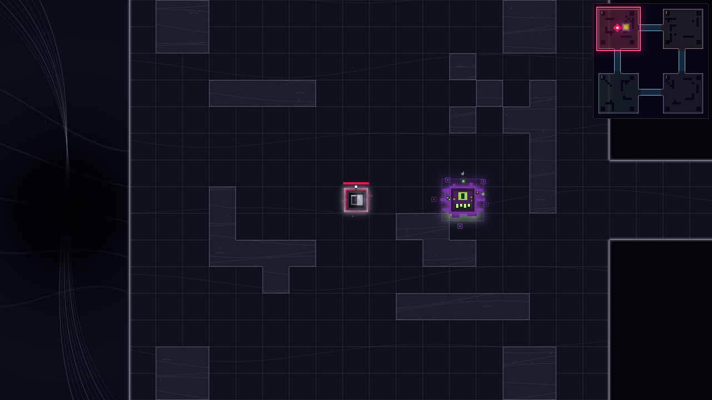

# The Singularity

[Overview](README.md)

A map preview at `/challenge/singularity`, available from the star map. The existing Soul Devourer spawns immediately in ALPHA using his standard behavior. No custom challenge mechanics or C skill are added. Regular aliens, subsequent automatic bosses, meteors and ambient events are disabled; normal movement, teleporting, Ruby and Singularity (F) remain available.

**The End:** a quiet dark cosmic environment, using the original Endless map's flat surfaces and fine boundaries as a material baseline. Floors are charcoal with faint tile seams, rare dust points and long gravitational surface traces. Joined dark-matter cover has a flat fill, continuous fine internal striations, suspended pinpoint dust and a single fine boundary; there are no raised top caps, shaded side faces, beveled rims or outlined cracks. Room accents remain ash lavender, dusty rose, cold slate and muted violet, shared across pads, borders, minimap and teleport picker.

The visual language is light being erased by gravity: surface traces stretch across floor tiles and joined wall masses; suspended dust gives dark matter depth; background stars trail into a web of fine gravitational filaments. Cold and violet lensing echoes cross those filaments, while a soft unlit absence obscures their centres. The background has a dark depth field with sparse dying lights, not solid decorative props. No giant polygon cliffs, floating wedges, framed portal, circular rim or accretion disc is used. Movement follows simulation time and continuous parallax. All scenery is cosmetic.

The star-map icon is an irregular torn black aperture with a pale edge and four muted silver-grey fragments. It has no ring.

`singularity-art.ts` owns the scenery; `SingularityGuide.tsx` supplies the short map sheet and F card. `node scripts/preview-singularity.cjs docs/visual-reference` renders the actual arena in two chambers and verifies rendering does not mutate state.

