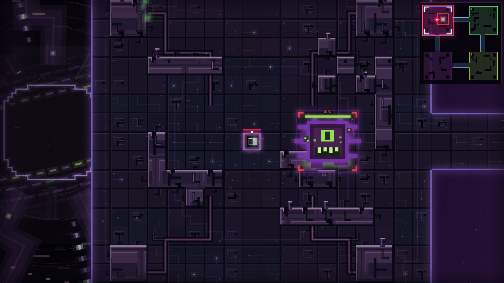

# The Singularity

[Overview](README.md) · [World look](#world-look-the-devourers-maw)

`/challenge/singularity` is a three-round fight against a multiplying Soul Devourer swarm. Eating Souls creates more bodies; you hook bodies with the Gravity Hook and fling them into two Maws, which take turns opening wide and swallow copies permanently. Defeating every body completes a phase, and clearing phase 3 wins. The original starts with nine stacks in phase 1 and ten in phases 2 and 3. Phase 2 adds Golden Souls and toxic gas; phase 3 has the same rules as phase 2 for now (a phase 3 twist is planned).

Tuning is `SINGULARITY_CHALLENGE` in `constants.ts`. The swarm lives in `engine.ts`, Maws, the Gravity Hook and Souls in `singularity-maw.ts`, scenery and effects in `world-themes.ts`, and the concise rule sheet in `SingularityGuide.tsx`. `TetherStatus.tsx` draws the Gravity Hook HUD icon.

Other bosses, regular aliens and space events are off. Meteors still fall and destroy every Devourer copy in the struck chamber without creating offspring; the phase's original is immune to them, so it always bursts. Bodies in other chambers survive; clearing the last body advances the phase normally. The book button opens [The Universe Is Not a Buffet](SINGULARITY-LORE.md).

## Swarm

Each phase starts with a 150-HP original at its maximum stacks: nine in phase 1, ten in phases 2 and 3. It swells in place for three seconds (`gorgeTicks`), then bursts into one stackless copy per stack, scattered across the map. The original cannot be swallowed or pulled by a Maw. Its burst within six tiles deals 18 player damage, a three-tile shove, 7 damage to placed Ruby and 30 to other enemies, sparing Souls. Killing the original before its burst instead creates one copy per two stacks, rounded up: five in every phase.

Copies start empty at 130 HP in every phase and scatter at triple speed for their first two seconds. Each Soul eaten adds one stack (`mealStacks`): +25 max HP per stack (`stackHP`), healed to full. A body shows its stacks above it (x2/3; the original x9/9). A copy is full at three stacks (`bodyStacks`, so three meals; only the original carries the phase's nine or ten). Reaching full lights its fuse, which keeps burning while it is pulled, towed or thrown (it can burst mid-pull) but pauses while the body is stunned (a slam, wall hit or landing), resuming when the stun ends with a charging sound: it swells and flashes red for three seconds, then bursts like the original (the same blast), leaving one copy per stack (three), scattered across the map; each copy flies off as a comet and falls from the sky onto its spot exactly like a jump (no jump blast where it lands). Killed by hand, a body leaves one copy per two stacks too (none at zero stacks). Swallowed by a Maw or F at any point, even while its fuse burns, it is gone with no copies. Bodies never bud on their own. So a phase cannot end too fast, during its first 30 seconds (`loneBodyTicks`) a lone body that is not already bursting or held bursts at once with the phase's full stacks (nine or ten copies), with the usual blast. Every 8–14 seconds each copy flickers for half a second, then jumps (`bodyJump`): with no Lost Soul within its food range it usually (60%, `toFoodChance`) lands beside a random soul anywhere on the map; otherwise on a random open tile at least four tiles from you; bursting (the burst flash, shockwaves and debris, with the burst sound; a smaller blast where it leaves deals 6 and a two-tile shove to you and 3 to a placed Ruby within four tiles, `jumpBlast`, as does a stackless body flung by gas) and flying there as a green comet that climbs high over the map to a point six tiles above its landing spot (`SINGULARITY_FALL_HEIGHT`). Meanwhile a shadow inside pulsing green corners darkens and grows on the landing tile. The body then drops straight down from the sky over its last quarter second (`SINGULARITY_FALL_TICKS`) with a green and violet streak above it, and lands with a light shake, a low thud (`bombExplode.wav`, `land` sound cooldown), a white-green flash, a dark crater, flat green and violet shockwaves and kicked-up debris, and a brief swell; the original, bursting, newborn, hooked and flung bodies do not jump. A body in the air (about 0.8s in all, `SINGULARITY_LAND_TICKS`) waits and is out of reach of Maws, F, gas, the Jaw, Gnashers and the hook; hooking a body cancels its pending jump and restarts its jump timer, and a body in mid-jump cannot be hooked (a hooked body still bursts when its fuse runs out). The family cap is 40 bodies in phase 1, 48 in phase 2 and 56 in phase 3 (`familyCap`); copies past it are not made. Meal cooldown starts at a third of a second, increases with generation up to about 1.2 seconds, and newborns initially wait a fifth of a second.

Bodies walk 65% faster than the ordinary Devourer (`bodySpeed`). Eating a Soul gives that body 40% more movement speed for three seconds (`mealSpeed`, `mealSpeedTicks`); another meal refreshes the duration without stacking the multiplier. Full bodies still stop to burst. They chase food within twelve tiles, and otherwise run from you when you are within six tiles (`fleeRadius`) or roam to random spots away from you, routing around Maw reach (food paths can enter it). A body you hit (your attacks or skills) drops its food and hunts you for one second (`aggroTicks`); every hit restarts it. Newborns first scatter. A body still bites you or Ruby when in reach. Bodies spread out: one standing on or next to another usually (60%, `spreadChance`) steps to the free adjacent tile furthest from its neighbours instead of following its path, unless a Lost Soul is within two tiles; newborn, bursting, hit and held bodies do not. Bites can hurt either target, with damage reduced as the family grows; the challenge bite multiplier is 0.9, reduced to leave room for Convergence’s arena hit. Thirty percent of player bites shove two tiles.

Size, speed and bite weaken slightly over the first two generations, then stop weakening. A body that is hooked, in flight or stunned by a slam neither moves, bites nor eats on its own. The guardian bar shows living bodies against the family cap, rather than their combined HP.

## Convergence

After a 28-second cooldown, the Devourers are pulled into one randomly chosen floor tile **one at a time**. Each flying body keeps its actual stack- and generation-scaled model size. Waiting bodies keep their ordinary movement, attacks, meals, jumps and burst fuses until their own turn starts. At that moment the pull captures their live position and size, then makes them invincible and pauses their AI/fuse. A body defeated or burst before its turn is skipped rather than restored. Gathering lasts at least two seconds, or six ticks per body if longer (four seconds at the phase-1 cap of 40, 5.6 seconds at 56). Each arrival briefly swells the giant. The last arrival immediately explodes it back into the same bodies: there is no separate charge/detonation delay. Identities, HP, stacks and ordinary burst fuses are preserved, with no healing or offspring.

Only a body whose pull has started and the giant are invincible, including against meteors, and cannot be hooked, pulled or eaten. Waiting bodies remain vulnerable and use their normal AI. Maws, Jaw, gas and food spawning wait during gathering, while existing jump, burst, landing and swallow visual timers keep advancing. The explosion hits the whole arena once: `ceil(30 × bodies / phase family cap)` player damage and half rounded up to Ruby (maximum 30 and 15), with normal guards/shields and no knockback. The visual shockfronts reach every map corner even from an off-centre gather point. A Venus-style screen-space burst also stays visible spilling from just beyond the nearest screen edge or corner when its origin is offscreen, with poison-green gas puffs, germ spores, pale Soul wisps and a fading directional pressure band. The fallout is cosmetic. Full-sized bodies fly back to their old floor tiles on the ordinary landing timer. The blast visuals last 3 seconds, then a 28-second cooldown starts. The bar beneath the guardian bar counts down to Convergence, then shows gathering and explosion progress, without seconds. Phase transitions/reset clear it. **Converge** in the God panel triggers it on the next gameplay tick. Tuning is `SINGULARITY_CHALLENGE.convergence`.

## Souls

The God panel’s **No Mobs** toggle stops Soul, Golden Soul, Soulless and Contaminated Soulless spawning. Turning it on removes existing non-boss mobs and clears pending spawn warnings, while retaining the Devourer swarm. Their spawn timers pause while enabled and resume when disabled.

Four souls are announced when the fight starts. Living souls, the Soulless and pending signs all carry over from one phase to the next. One more is announced every 0.75 seconds (`soulSpawnTicks`), up to sixteen living or incoming souls (`soulCap`). From phase 2, a quarter of new souls are Golden Souls (`goldenFromPhase`, `goldenChance`): their sign and the soul are gold, they run from you about 60% faster (`goldenFleeSpeed`), and a body that eats one is filled to full stacks at once, lighting its fuse. A blinking diamond marks each spawn for 1.5 seconds on the floor and minimap before it appears.

Souls drift within their chambers and never attack. When you come within three tiles, a soul runs from you, on any floor, at about twice its drifting speed (`soulFleeRadius`, `soulFleeSpeed`). It does not run from the swarm, so bodies run souls down while you race them. They die in one hit; killing one heals the player two HP. Devourers must reach a soul's tile to eat it. Maws neither pull nor swallow souls.

## Soulless

A physical skeleton with no soul that hunts you (`soulless`, a physical lunge attacker: 30 HP, speed 4, 12 damage to you, 8 to a placed Ruby, a 25-tick recovery after a lunge and a 24-tick warning, ordinary kill rewards). One is announced every four seconds (`SINGULARITY_CHALLENGE.soulless`) by a grey version of the soul sign, up to three alive or announced in phase 1, four in phase 2 and five in phase 3. The swarm never eats one, so it never feeds the Devourers; Maws and F pull it but never eat it. It is a simple physical bone husk: one large square ash-bone shell with a darker inset, two empty square eye sockets, a small tooth slit and two short feet. It has no separate ribs, spine, arms, glowing heart, soul core, ghost tail, aura or soul particles. The body fraction is 0.9 (43px); the drawn shell is 40px square with a small alternating footstep. Injured units use the standard non-boss HP bar; full-health units hide it. [Model and HP bars](visual-reference/soulless.png). Its skull uses clipped upper corners, a narrower jaw and a small dark nose notch. Within six tiles with clear sight, it braces for 0.4s, locks a cardinal direction, then lunges up to six tiles at 13px/tick. It stops early on contact or at cover and swipes once (1.15-tile reach, forward side, line of sight required), dealing 12 player / 8 Ruby damage and pushing the player two tiles. Knockback respects walls, carrying Ruby, Ursa and CC immunity. It recovers in place for 25 ticks (about 0.42s), with an 80-tick attack cooldown from the swipe. Dodging leaves the attack on its original line. Pushes and stuns interrupt it. There are no laser attacks or ranged projectiles. [Lunge stages](visual-reference/soulless-lunge.png).

## Contaminated Soulless (phase 2+)

From phase 2, about a third of Soulless spawns are Contaminated Soulless (`toxic_soulless`; `toxicFromPhase`, `toxicChance`), announced by a green-grey sign and counted in the same cap. It fights exactly like a Soulless (the same lunge and swipe; 30 HP, 8 damage to you, 5 to Ruby) and the swarm will not eat it. Wherever it dies (killed or eaten by the Jaw) it leaves a still gas cloud, larger than a drifting one (2.6 tiles, `cloudRadius`) that lasts 8 seconds (`cloudTicks`) and never moves; it slows and blurs like any gas, without dealing damage and bursts Devourers that touch it, with `poisoned.wav` at .45, pitch .8. It looks like the bone Soulless with a few parts soaked in poison-green toxin (the top-left of the skull, a dripping patch on the right cheek and the left foot) and gas rising from each soaked part.

## Toxic gas (phase 2+)

From phase 2 (`SINGULARITY_CHALLENGE.gas`), five clouds about 1.8 tiles in radius drift slowly (0.35 px/tick), turning gently and bouncing off walls. Each lives 15–20 seconds, fading in and out over 1.5 seconds, and a new one forms at a random floor tile at least four tiles from you. Inside a cloud you move at 60% speed; gas deals no damage. A Devourer that touches a cloud (once it is a third faded in) bursts at once: with stacks it explodes like a full body (the same blast, one copy per two stacks, the original one per stack); with none it bursts and is flung to a random floor tile clear of gas and at least four tiles from you, its comet arcing there. Hooked and thrown bodies pass through. The cloud is drawn in the wall pipes' smoke style over the units: layered soft poison-green squares with fainter shade halos, swelling and turning, with motes rising off it. While you are inside, a strong green tint and many large drifting smoke squares make it hard to see, thicker the deeper you are. The minimap shows each cloud as a soft green patch.

The F field also shows on the minimap: its reach as a dashed silver square with a dark core, blinking in its last two seconds.

## Gnasher (phase 3)

In phase 3 each new copy has a quarter chance to be a Gnasher (`SINGULARITY_CHALLENGE.gnasher`), at most three alive. It walks 40% faster and jumps across the map about twice as often (every 4–7 seconds). Every four seconds it can bite: it hunts the nearest other copy within eight tiles (ahead of food) and bites one within 1.5 tiles. A bitten body with stacks bursts at once with twice its stacks, so twice the copies; one with no stacks splits into two. It never bites the original, a bursting body, another Gnasher or a hooked or thrown one. It is told apart by shape rather than colour (red belongs to the full-stack warning): pale bone spikes jutting from all four sides and a wide dark mouth of jagged white teeth across its face, with a white diamond on the minimap; its bite is a violet beam with `slash.mp3` (sharing the 1-second cooldown).

## The Jaw

Five seconds into each phase, then every 4–6 seconds in every phase (`SINGULARITY_CHALLENGE.jaw`), a jaw opens under you: a 3×3 area centred on your tile shows a dark blocky core with a pulsing poison-green rim and fangs pointing in from all four sides, blinking faster for 0.8 seconds. Then it snaps shut, collapsing to its centre like a small black hole core. As it shuts it swallows every enemy caught in it, like a Maw (Devourer copies, Soulless and Souls, with the usual swallow heal and Feast chain), but never the original. If you are still inside, you take 15 damage and are thrown six tiles past your offset to the far side of its centre, along the axis you are further off it on (left of centre → right, above → down; dead centre, back against your facing), stopping at walls. Its knockback moves at 2.4× normal knockback speed (`knockSpeedMult`) without changing the distance. There is no stun. Out of the area, it bites empty air. Its warning plays `charging.wav` low; the bite plays the supplied monster bite (see [Audio](AUDIO.md#singularity-jaw)), and a hit adds `hitHurt.wav`.

## Gravity Hook (C)

A thrown Devourer copy entering an active F Singularity’s inner two-tile radius is swallowed immediately, with the same healing and Feast chain as a Maw and no offspring.

Holding the Primal Skill latches onto the nearest copy or non-boss mob within eight tiles in sight (`SINGULARITY_CHALLENGE.hook`), including Souls, Soulless and Contaminated Soulless. The original and bodies in mid-jump or Convergence cannot be caught; a bursting copy can, and its fuse keeps burning. Held or flying Souls are not eaten by the swarm. Cyan corner brackets and a faint dashed line mark the body the hook would catch whenever it is ready. The held body trails you on a cyan tether, a step at a time, never closer than about 1.6 tiles, and its own AI waits.

Releasing C, or holding for three seconds, draws the body into your hands and throws it from your tile the way you face, up to seven tiles, one fast step at a time. Auto-aim bends the throw toward a Maw (preferred) or another body within 30 degrees of your facing and within eight tiles (`aimCone`), stepping in a staircase for a diagonal line. Bodies next to the launch tile are not hit; only what the throw reaches:

- **Into a Maw:** a Devourer copy reaching its inner two tiles is swallowed at once, open or not, with full swallow and Feast rewards. Non-boss mobs are never eaten by Maws or F, including when thrown into them; F still deals its normal periodic damage.
- **Into another body:** both are stunned for 3 seconds (`slamStun`), with no damage. The impact flashes white with a jagged white-and-green star, white then green shock squares, and sparks and chunks bursting out and falling.
- **Dazed:** any stunned body (slam, wall or landing) has three yellow-and-white stars circling above its stack label on a faint yellow ring, blinking out in its last half second.
- **Into a wall:** it is stunned for 1 second, with no damage.
- **Out of tiles:** it lands with a half-second stun.

There is no cooldown: after releasing a body, you can immediately grab another eligible body. The HUD shows a blocky hook icon with a ready border. A new phase clears the hook, flights and cooldown. The god panel offers Ready Hook.

## Maws

Two Maws occupy separate chambers. Their clear 3×3 centres avoid the player and Ruby; teleport pads stay outside the inner two tiles when possible. Each Maw teleports every 35 seconds (`mawMoveTicks`; the second first moves 17.5 seconds later than the first) to a spot in a chamber neither Maw is in or heading for. For the last 5 seconds (`mawPreview`) it turns green and a faint hint marks its next spot, so it never reads as a second Maw: a faint, thick dashed green outline of its resting reach and a small hollow green ring with a thick border at the centre (no fill, no black core), fading in and pulsing a little faster as the move nears, with three faint motes arcing from the old spot to the new one. The minimap still marks the next spot. Its final fade-out only runs while it rests, so it never leaves during a warning or an open window. It collapses where it was and fades in at the new spot, keeping its place in the open cycle, and the swarm re-routes around its new reach.

Each Maw runs a repeating window (`mawCycle`): 16 seconds resting with a small two-tile reach, a 1.5-second warning in which its wide reach blinks in faster and faster, then 3.5 seconds open with a five-tile reach and pulls every six ticks. The open reach eases in from two to five tiles over its first half second and back down over its last 0.75 seconds (`mawWindow` `open`, used by both `mawReach` and the drawing, whose colours blend the same way), so opening and closing are smooth. The two Maws are half a cycle apart, so one opens about every 10.5 seconds. Enemies in reach are pulled toward the centre with smooth forced steps that respect walls, faster within two tiles. An open Maw pulls you within five tiles (its whole wide reach), one tile every 30 ticks, or every 15 within two tiles of its centre. A resting Maw pulls you only from the tiles right around its centre (`playerRadius` 1.5), one tile every 50 ticks. Touching the centre deals 30 damage and flings the player three tiles out, at most once per second. Ruby is anchored. The god panel's Open Maws holds both open until pressed again (Cycle Maws).

The centre consumes a copy permanently and heals the player and Ruby. Swallowing copies within four seconds of each other builds a **Feast** chain (`feastWindow`): the first heals 8, each link 50% more, up to ×4 (8, 12, 16, 20), and gives 4 star energy per link. The chain shows no text or sound of its own; each swallow keeps its usual effect. Maws and F only eat Devourer copies. Other enemies can be pulled but survive at their centres; Souls remain exempt from Maw pulls. The Jaw still eats non-boss enemies caught in its bite and gives its usual rewards.

The backdrop black hole gulps each time a Maw opens, in step with its suck (see [World look](#world-look-the-devourers-maw)).

## Celestial F

F keeps its five-tile radius and damage, but here it lasts 9 seconds (`fTicks`, 18 elsewhere) with a 12-second cast cooldown. In this challenge it pulls every ten ticks, with heavy bodies affected on five of every six pulses.

F stays where you cast it; Maws never draw it in or absorb it. Its own centre works like a Maw's (`swallowAtField`): a copy pulled onto its centre tile is swallowed whole, with the same heal and Feast chain. The original is never swallowed, and Souls and aliens only take its damage and pull.

## Visual direction

Keep the established violet Maw, green swarm and crisp blocky neon-vector shapes. A resting Maw shows its small reach; while warning, its wide reach blinks in with a dashed pale outline and faint tiles; open, the wide reach brightens with faster inward bands. The hook is cyan: breathing corner brackets on the catchable body, then a three-band tether with link blocks and a frame on the held body that blinks white near the hold limit. A flung body trails cyan blocks and a short glowing streak; a slam flashes a white square, pale core and green-and-pale debris; a wall hit flashes a cyan square. Maws keep their fade-in, and the cast F keeps its own field art.

[Maw resting, warning and open; hook target, tow, fling, slam and Feast](visual-reference/singularity-hook.png) (source-rendered art layers on a plain floor)

## World look: the Devourer's Maw

A vicious darkness swallowing a dying station. Monumental scale, broken silhouettes and inward motion give it the weight of the final boss's domain. Keep every solid form blocky, with stepped cuts, broad flat faces and selective violet/poison-green accents.
- **Rooms:** ALPHA violet `#a77bff`, BETA green `#7dff8a`, DELTA orchid `#e06bf0`, GAMMA lime `#d0ff6a`.
- **Cover:** joined black-violet monoliths with broad world-space plates, deep rectangular splits, pale fractured upper lips and void-bitten edges. Sparse inner violet/green fissures pulse beneath the shell. Broken obelisks rise from some exposed upper faces; short hooked black roots reach onto nearby floor. Now and then a wall pipe vents a puff of poison-green smoke that rises, drifts and fades. The collision footprint remains the full tile.
- **Floor:** dark, cleaved station plates, each 3×2 plate in its own dark tone with a slight violet, plum or green cast, faint bevels and corner rivets. Some plates carry faint etched circuit traces whose nodes pulse now and then; faint blocky rounded gravity ripples flow inward across each chamber. Sparse severed fittings and large branching, axis-aligned stress fractures. Restrained violet cores pulse inside deep black faults; occasional small green remnants travel along them. Sparse ash accelerates inward. Decoration stays dimmer than actors and avoids warning symbols or enclosed attack areas.
- **Backdrop:** dramatic and violent. A purple tint deepens with distance from the core: none until about the middle of the view, then growing stronger toward the far edge. Distant stars near the maw are lensed into arcs bending around it. A vast tilted accretion disc of violet, orchid and poison-green light spins around the abyss, blazing brighter on its approaching side, its far half passing behind the maw. The core is a blocky rounded square: concentric horizon layers with straight sides and broad stepped rounded corners, and a bright photon ring tracing the same stepped outline. The broken structural arms turn slowly and carry violet and green energy pulses racing inward; twin flickering jets lance from the poles; a planet is torn apart, its blocks spiralling into the maw. In the challenge the maw gulps each time one of the Maws on the floor opens (`syncSingularityGulp`; a Maw held by the god panel adds none); anywhere else it gulps every 45 seconds, the first time 45 seconds in: the core (horizon layers, slabs and photon ring) squeezes in by about a fifth over the first three seconds, then springs back slightly past its size and settles; the accretion disc tightens and flattens with it, the structural arms are drawn in toward the core, and the twin jets flare longer and wider; everything flowing inward (debris, starlight, the torn planet's stream, arm pulses and contracting plates) surges faster through a shared time warp that builds over the gulp and is kept afterwards, so nothing jumps; stars bend harder around the maw; streaks of light rush in from every edge and rings in the core's blocky shape race inward while the sky dims; the disc's spin surges, a violet shock ring fades in as it contracts across the sky, the screen edges darken, and a green glow in the core's blocky shape swells and fades over about three seconds. Every gulp envelope eases in and out, and the extra spin accumulates, so nothing snaps between cycles. Beneath it all sits a colossal stepped black abyss beside the platform, with interrupted uneven horizons, inward hanging slabs and black bites through the rim. Huge broken structural arms converge behind it. Severed hull blocks and stretched starlight accelerate inward; disconnected plates contract toward the unevenly breathing core. Moving structures rotate as whole solid shapes.
- **Atmosphere:** while a Maw sucks (`singularityOpenness`), the background behind the station (`drawSingularitySuction`, drawn under the floor and units, with no camera shake) is dragged into the backdrop black hole, everything centred on it as it drifts with the camera (`singularityHoleCentre`): a deep violet-to-black radial darkening, a huge vortex of spinning green, violet and pale rings shrinking around a black core, and over a hundred long speed lines with tumbling debris curving into it. Otherwise restrained dark pressure at the screen edges and sparse elongated remnants pulled toward the abyss, drawn over scenery and actors before the minimap/HUD. All motion follows the simulation tick. Fractures, obelisks, roots, pressure and debris are visual-only; no new hazards, collision or challenge mechanics.

The Singularity star-map icon is an irregular torn black aperture with a pale edge and four muted silver-grey fragments.

## Checks

`tests/singularity-challenge.test.cjs` covers phase progression, identical tuning, bursts, meal stacks, pursuit, the Gravity Hook (latching, towing, flings into Maws, slams, walls, the hold limit and cooldown), Maw windows and player pull, the Feast chain, fleeing souls, swallowing, the Jaw, toxic gas, body jumps, and F staying put and swallowing copies at its centre. `tests/devourer-range.test.cjs` protects the ordinary Devourer encounter. `scripts/preview-singularity.cjs` renders current source and checks that art does not mutate game state.
