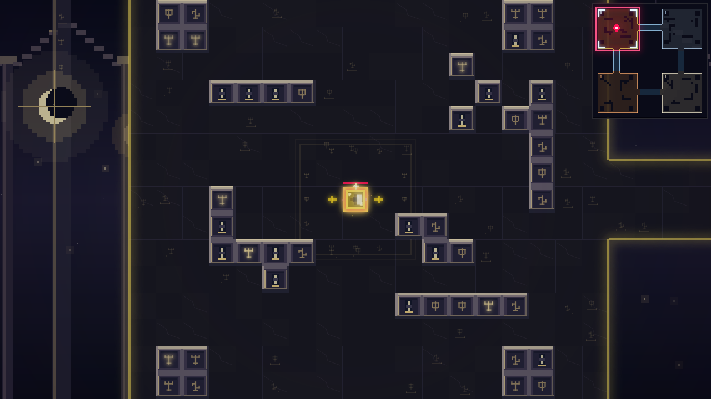
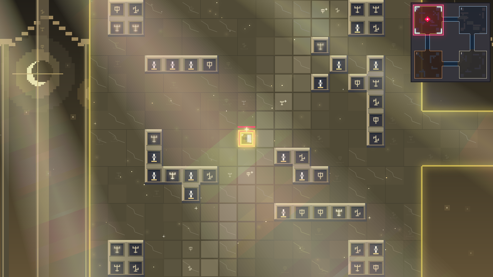
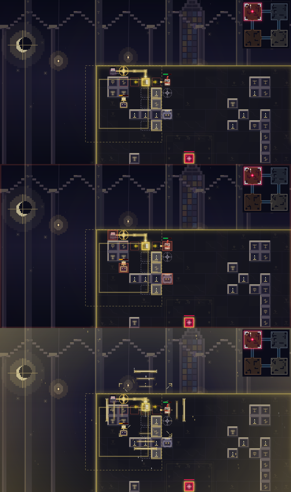
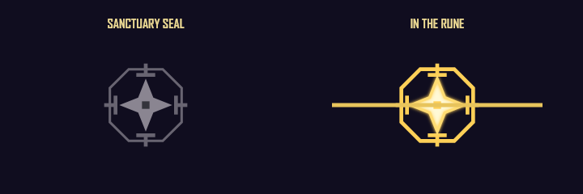
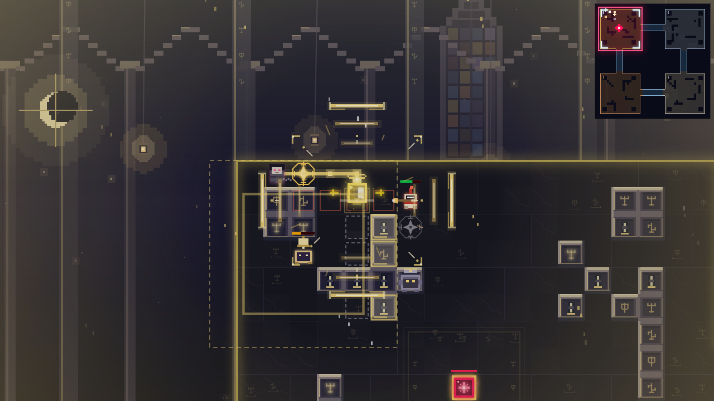

# Sirius

[Overview](README.md) · [Gameplay](GAMEPLAY.md#modes-and-lobby)

Normal spawn slots draw from the [shared challenge alien pool](ENEMIES.md#shared-challenge-alien-pool) like the other maps: Armored, Healer, Runner and Charger join on the opening schedule, then Ghost, Bomber and Lancer after 60 seconds, with rare Shooters. The map’s own enemies retain their existing spawn rules.

`/challenge/sirius` is a fight against the Blind Prayer, who never attacks. **Holy Light is how you hurt him:** he keeps casting runes that you trace by walking, while his aliens try to knock you off course. Traced runes fill your energy and Holy Light; with full Holy Light, your primal skill Sacred Halo bursts across the arena. He has three phases of 1,200 HP (3,600 total). Phase 2 adds the Mason, 4-stroke runes and quicker light/dark swaps; phase 3 adds the Penitent, Sanctuary Seals and only 4–6-stroke runes. The guardian bar shows the phase. Only the final defeat wins. Tuning is `SIRIUS` in `sirius.ts`; art is `sirius-art.ts`; scenery is the Sirius `WorldTheme` in `world-themes.ts`; the rule sheet is `SiriusGuide.tsx`. The primal skill (C) is Sacred Halo; Sirius Surge (F) is the celestial skill; its star, diffraction spikes, sparkle halo and orbiting companion use a 1.3× enlarged cast silhouette. [Surge cast stages](visual-reference/sirius-surge.png). The C icon is `HaloStatus.tsx`.

Regular alien spawns and space events are off; meteors still fall and take 10% of a phase (120 HP, `meteorShare`), like the other maps from him. In the challenge the Prayer keeps his roaming and fleeing, but his escape attack, his own Ruby ritual and his reversal of your controls are off (`sirius` checks in `engine.ts`).

Sirius’s book button beside Begin Challenge opens [The Light That Waits](SIRIUS-LORE.md), the story of the Blind Prayer and the sanctuary’s travelers.

## Light and dark

- The sanctuary swaps on a timer: 18 seconds of light (`lightTicks`), then 12 seconds of dark (`darkTicks`). In phases 2 and 3 light lasts 16 seconds and dark lasts 10 seconds (`laterLightTicks`, `laterDarkTicks`), starting as soon as phase 2 begins. Both natural phase entry and the Phase 2/3 God buttons cap the current timer at the shorter duration without extending a cycle already near its end. Older saved timers are capped on update, and the HUD fill and meter stay within 0–100%. It starts dark (reversed controls), also after RESET.
- **Light:** normal controls. **Dark:** your movement is reversed (`isMovementReversed` follows `siriusReversed`).
- The supplied church bell toll warns 2 seconds before each automatic swap (`swapWarning`), loud with softer stereo cathedral echoes; the HUD bar turns white. A sanctuary-themed screen overlay builds during those same two seconds: warm ivory/gold for incoming light, shadowed violet and dim gold for incoming darkness, with broad translucent side curtains, large stepped sanctuary corners, bright double edge lines and sparse prayer lights. The center stays clear, with no text or icon. The warning follows the existing timer and stops immediately when the swap occurs; God-panel manual swaps still skip it. [Incoming light](visual-reference/sirius-swap-to-light.png) · [Incoming darkness](visual-reference/sirius-swap-to-dark.png). On the swap the holy healing recording (`sirius-heal.mp3`) plays, pitched lower as the dark falls, with a brief screen wash. The scenery uses the existing 0.6-second lighting transition (`trial.siriusLight`).

## Runes

- The first rune comes 6 seconds after he arrives (`firstRune`), then 7 seconds after each one ends (`runeGap`). Each cast takes 1 second (`runeCast`) and plays the arcane seal recording (`sirius-rune-cast.mp3`); tracing starts fresh when it ends.
- You have 20 seconds in phases 1–2 and 25 seconds in phase 3 (`phase3RuneBonus`) to walk the rune's shape in one unbroken line. Runes (`RUNES`) are short stroke lists, each stroke so many tiles in one direction (for example HOOK: 3 right, 2 down, 1 left). Orientation matters; position does not. They come in tiers by stroke count: tier 1 has three strokes (HOOK, STAIR, CROWN, CUP, BOLT), tier 2 four (SPIRAL, WAVE, KEY) and tier 3 five or six (SERPENT, TOWER, LADDER). Phase 1 draws tier 1, phase 2 tiers 1–2, phase 3 tiers 2–3 (`runeTiers`); a rune never repeats the previous one.
- **Pattern variety:** 23 runes: nine three-stroke shapes, seven four-stroke shapes and seven five/six-stroke shapes. Phase 1 draws from nine patterns, phase 2 from sixteen and phase 3 from fourteen. Every pattern fits the trail limit without crossing itself. Separate strokes may touch; an ivory centerline (12% of a tile, minimum 1.25px) without an outline, with small square markers (about one-quarter of a tile, minimum 2px) at its beginning and end, follows the exact walking order from the outlined start tile, connecting only consecutive tiles rather than every neighboring pair. The HUD, rule-sheet examples and pattern reference share this painter. [Rune pattern reference](visual-reference/sirius-rune-patterns.png).
- **Matching** (`runeProgress`): the end of your trail is compared with the rune. The first stroke may be longer than drawn (you can walk in from that direction); every later stroke must match exactly, so overshooting a turn spoils it until you start over.
- **Trail:** every step adds a tile (up to 30). A knockback, teleport or any jump breaks it and starts a new one.
- **Sanctuary Seals (phase 3):** each rune scatters eight seals per chamber (32 total) on reachable floor, repositioning them at the next cast. The rune completes only when any one seal lies within the matched rune shape, including its start or end tile. Earlier approach steps, including extra length before the required first stroke, do not count. During tracing, only the currently matched part of the rune can light a seal and unlock the HUD. Losing that match, erasing the seal tile or breaking the trail removes coverage. Placement leaves a full unobstructed copy of the current rune starting at each seal, avoids Ruby and pads, and Mason walls cannot cover seals. Open octagonal gold tracery surrounds an ivory four-point light, engraved directly into the marble with floor visible between the lines. Unused crests are muted gray stone; including a seal turns its tracery saturated gold and its center bright ivory with restrained warm glow. Until the matched rune shape includes a seal, the HUD rune square is desaturated gray, leaving its shape unobstructed; including one restores its gold color, and losing coverage makes it gray again. There is no seal text beneath the health bar. The minimap marks seal positions. They appear during the cast and tracing, with no separate damage or pickup effect.
- **Traced:** he takes 60 damage (`runeDamage`, 5% of a phase), not reduced by his armour; you and Ruby each heal 45 (`runeHeal`) and get full energy; for Holy Light it counts as exactly one full bar of energy (+15) however full your gauge was. A gold strike falls on him with a gold screen burst and the holy seal recording (`sirius-rune-seal.mp3`).
- **Missed:** the Prayer heals 60 HP (5% of a phase, `runeFailHeal`), capped at the current phase’s starting HP. you lose all your energy and 20 Holy Light (`holyFailLoss`), and every alien moves 35% faster and hits 60% harder for 10 seconds (`wrathTicks`, `wrathSpeed`, `wrathDamage`; `siriusEmpower`). They get a red square aura, a red screen pulse and frame, and ALIENS EMPOWERED shows under the HUD.
- **His armour:** your weapons and skills deal only 5% to him (`directDamage`).

## Holy Light and Sacred Halo

- **Holy Light** (0–100, `sirius.holy`) fills with every point of energy you gain, at 0.15 per point (`SIRIUS_HOLY_PER_ENERGY` in `constants.ts`, applied in `addStarEnergy`). A traced rune, a right Ruby guess and Sirius Surge (F) each count as exactly one full bar of energy (+15), however full your gauge was; every other energy point counts on its own. About four traced runes fill it with the kills between them, as before. It is a gold bar in the top HUD with a cross icon; when full it glows and shows the C hint.
- **Sacred Halo (C, primal skill):** every cast releases a wide knockback wave, pushing living aliens within 6 tiles outward by up to 5 tiles (`haloWaveRadius`, `haloWavePush`), using normal wall-blocked knockback. When the push ends or hits a wall, the alien is stunned for 0.3 seconds (`haloWaveStun`), using the shared enemy stun timer; the stun is queued during movement so it cannot prevent the knockback. It does not move the Prayer or deal damage on its own, and interrupts a displaced Sirius alien’s attack so a dash cannot resume from its old position. The pulse expands from the cast position as three layered sets of separated gold cardinal bands with ivory cores, inset rails and squared tips, accompanied by four detached corner crests, short radial rays and square lights. A brief square sanctuary seal and horizontal ivory flare anchor the release; crisp rectangle geometry and open gaps keep the battlefield readable, with no continuous ring over 0.5 seconds (`haloWaveTicks`); it pauses with gameplay and clears with the encounter. Alongside the wave, for 6 seconds (`haloTicks`) you float under a gold halo and small crown: you can walk over any station wall inside the map (not the outer edge; `siriusCanFloat`) and move 40% faster (`haloSpeed`). Your trail keeps counting, so runes can be traced across walls. When it ends over a wall, you land on the nearest floor. 15-second cooldown from the cast (`haloCooldown`), reset the moment Holy Light becomes full; the shared skill-ready chime plays when it is ready. Cast sound: `sirius-heal.mp3`, pitched up.
- **Burst:** casting Sacred Halo with full Holy Light also spends it all: the Prayer takes 240 unreduced damage (`burstBoss`, 20% of a phase) and every other enemy takes 90 (`burstAlien`), over 2 seconds: a brief ivory flash and gold wash, with a rich gold screen gradient with a concentrated amber-gold centre immediately around the player (55% centre opacity before the shared fade), softening outward toward the edges; this gradient follows the player and renders behind the character shell, alongside the cathedral beams. Twenty-six subtle block-built gold/ivory feathers drift outward from the player, rotating as whole shapes; an arena-wide version of Sacred Halo with five open cardinal fronts, ivory cores, inset rails, squared tips and four detached corner crests, with 48 small prayer lights; a wide pillar of light slamming down on every enemy (longest on the Prayer); matching separated screen-edge bands and gold/ivory corner crests; and a stronger shake (36 ticks, strength 11). Full-charge fronts use 2.5× the normal wave’s band thickness, ivory cores, squared caps and corner crests, with longer light rays and stronger screen-edge bands for a dramatic release. Eight ivory/gold cathedral beams with alternating broad and narrower shafts shine outward from the player with smoothly feathered sides and fading tips. Every shaft shares the same brightness and fade envelope: a short rise and continuous cosine fade to zero together. Adjacent feather strips avoid opacity buildup from nested layers; the shaft and tip gradients taper smoothly, and the beams stay at fixed angles while following the floating model. They render behind the player shell and halo so the character stays in front of the light source. A broad, clearly visible translucent square light wash travels outward behind the fronts (a 34% base opacity with a stronger outer weighting, and a wake spanning 36% of its current radius), grading from rich, more opaque gold at the farther outer front to pale ivory in its inner trail, with feathered inner and outer edges. The wave stays aligned to the sanctuary and leaves open gaps between its fronts. [Full Holy Light](visual-reference/sirius-holy-burst.png). Balance: four traced runes deal 216 between them and build the 240 burst, so the burst is the main damage.
- Energy comes often here, so his aliens spawn with 2.5× their listed HP (`alienHpMult`): Zealot 55, Bellringer 70, Normal 13. They show the shared alien HP bar once damaged and always move 25% faster (`alienSpeed`); wrath multiplies on top.

## Ruby ritual and the guess

- While a rune is being traced with at least 6 seconds left (`ritualMinLeft`), every 25 seconds (`ritualCooldown`) he moves a placed Ruby to another chamber's pad (never into an active meteor warning).
- When it starts, game time stops and the room picker opens (the shared `laserTarget` picker, like the teleport menu): pick a chamber with 1–4 or a click; Ruby's own chamber is dimmed. ESC or the primal-skill button skips. The Sirius picker looks unlike the teleport picker: a rose-to-dark radial wash behind the map, a stepped gold double frame around the screen with a pulsing pink inner glow, and Ruby-pink corner brackets with pale diamond gems.
- Ruby moves 1 second after you choose (`ritualWindup`). A right guess adds 5 seconds to the rune (`guessBonus`, capped at its full time plus 5 seconds) and fills your energy (worth exactly one full bar of Holy Light, +15); a wrong one takes only 2 seconds off (`guessPenalty`). A skip changes nothing. Carrying Ruby prevents or cancels the ritual.

## Aliens

Zealots and Bellringers go after Ruby when a placed Ruby is more than two tiles closer than you (the shared alien rule); Normals use the shared chase. Spawned every 2 seconds (`spawnInterval`) up to 14 alive (`population`); from phase 2, 10% more: about every 1.8 seconds, up to 15 (`laterPhaseMore`): about 50% Zealots, 35% Bellringers (at most three; a Zealot instead when full) and 15% Normals. Wave and bomb shoves cancel their wind-ups (`interruptSiriusAlien`).

- **Zealot** (55 HP): within 5 tiles of you and roughly in line, it braces for 0.6 seconds while a red lane marks its path, then dashes up to 6 tiles straight in 14 ticks. Contact deals 12 and knocks you 3 tiles along the dash (breaking your trail); a dash through Ruby deals it 9. 2.5-second cooldown.
- **Mason** (phase 2+, 60 HP, at most three; one arrives every 6 seconds on its own timer): keeps about 5 tiles away. Within 10 tiles of you it hoists a stone tablet for 0.5 seconds while up to four tiles two steps ahead of you, across your facing, are marked with dashed outlines; then a wall of up to four tiles rises there for 5 seconds, every 4 seconds at most (`SIRIUS.mason`). Masons have a separate spawn timer and population allowance, so they never replace or crowd out other aliens; No Mobs and paused gameplay stop their spawning too. The tiles become real walls (`state.map`), blocking everyone, and sink back to floor when they expire or the encounter is cleared (`clearSiriusWalls`). They never land on you, an enemy, Ruby or a pad. Sacred Halo floats over them. Sounds: `grow.wav` as it hoists, `place_bomb.wav` and `falling-thing.wav` as the wall drops. Look: a squat slate-stone block with gold eyes and stone fists lifting a gold-edged tablet; raised walls use the sanctuary cover with a gold seam and a shrinking time bar, flickering before they sink.
- **Penitent** (phase 3, 55 HP, walking speed 1.75, at most two; about 25% of spawns from phase 3): a hunched ash-grey figure in a black cowl with a pale bone mask, red-violet eyes and a dragging chain. It walks to the oldest tile of your trail and erases it and everything older as it steps on it, leaving a dark smudge; if it eats into the part you have traced, that progress is gone. If it reaches you (within 0.6 tiles) your whole trail breaks. With no trail it walks at you. It only walks, so floating over walls with Sacred Halo shakes it off. Sounds: `deghost.wav` at .3 (pitch .7), a hollow ghostly wipe, each time it eats, `shieldBreak.mp3` at .4 (pitch .6) when it breaks your trail.
- **Bellringer** (70 HP): keeps about 4 tiles away; when you are within 3 tiles it lifts its bell for 0.75 seconds behind a dashed gold square, then rings a pulse (radius 3.5) for 8 damage and a 2-tile push away from it; Ruby inside the ring takes 6. 4-second cooldown.

## HUD

The guardian bar shows BLIND PRAYER · PHASE n with three segments. Below it: a LIGHT/DARK bar with time left (white before a swap) and a RUNE bar (red in its last 3 seconds; NEXT between runes). To the right of the HP bar the current rune is drawn as clear tiles, one per step, so each line's length can be counted; its start tile is outlined, and traced tiles turn bright. On the floor your trail is a gold line of tiles; the part matching the rune glows.

## Look

A sacred sanctuary for the Blind Prayer: carved inscriptions, reliquaries, monumental religious architecture and pools of holy light separated by deep darkness. Warm gold writing and pale stone contrast with shadowed violet interiors; light is precious rather than covering every wall.
- **Rooms:** ALPHA gold `#ffe45c`, BETA pale blue `#bfe0ff`, DELTA amber `#ffb070`, GAMMA cream `#fff6d8`.
- **Cover:** solid sanctuary stone with pale upper cornices, dark violet carved recesses and gold fictional prayer runes. A few inscriptions glow gently; other blocks hold narrow reliquary niches with pale light behind dark shutters. Joined cover shares exposed cornices rather than a luminous button border on every tile.
- **Floor:** long marble flags with sparse faint veins and scattered engraved prayer runes. In light only, a slow diagonal wave brightens individual tiles in warm gold, awakens the runes and catches tiny glints; its edges fade smoothly. Dark keeps subdued engraved markings. One restrained square prayer inscription surrounds each teleport altar.
- **Backdrop:** a tall pointed-arch stained-glass window (stepped stone tracery around a grid of dim coloured panes) glows faintly behind two depths of immense columns and stepped high arches, carved prayer inscriptions, deep shadowed openings and slow dust motes. The column count fills each repeat exactly, so every stepped arch lands on a pillar. Lanterns sway on long chains from the near arches; small prayer lights rise and flicker. A distant altar-star is partially eclipsed by darkness, echoing the guardian's blindness.
- **Lighting states:** both stay dim. Dark keeps violet stone and restrained gold writing, under a light indigo screen tint (14%, deeper toward the edges) that fades in and out with the light/dark blend; light reveals warm aged stone over dark gold/brown marble and a shadowed amber background. Brightness comes from three very broad, warm tapered light cones in one screen-space overlay, fanning from one source beyond the upper-left edge with feathered sides and dark gaps between them; their drift and shimmer run in four-second bursts followed by eleven seconds of stillness. Dark has no rays. Tiny white/gold floor lights drift briskly in light. Switching takes 0.6 seconds: a soft illumination front travels diagonally across each chamber, and background, overlay and minimap blend with it. `trial.siriusLight` is the target and `trial.siriusLightBlend` the cosmetic progress; the God panel's **Swap Light/Dark** switches immediately, skipping the automatic warning countdown and resetting the new state’s timer.
- **Aliens:** the Zealot is an upright ivory-armoured lancer with a dark visor and burning red slit, a red sash and a tall crimson plume; its long spear with a gold head turns as one solid shape to point along its dash or walk and draws back while it braces (the slit flares white), and it streaks with fading afterimages. The Bellringer is a robed violet body bearing a cream bell, lifted before each ring and shaking as it rings.
- **Sacred Halo:** while floating, your model lifts about 16 px above the floor (rising over a quarter second, bobbing, and settling as the halo fades; `siriusFloatLift`), your shadow stays on the floor and shrinks as you rise, a gold double-ring halo and cream crown hover above you, and motes rise. A screen overlay fades in with it: a warm gold edge glow that breathes, soft light from the top of the view and small upright feathers of light drifting up across the screen. It is up to 70% stronger in light, following the lighting blend, so it still reads against the light rays.

God controls: Phase 1/2/3 (summon him if absent and set that phase's full HP), Swap Light/Dark, Cast Rune, Ruby Ritual (readies the next ritual) Full Holy Light (also readies Sacred Halo) and Sacred Halo Ready. Sacred Halo Ready sits beside Skill Ready in the God panel. During a Ruby ritual the god panel shows RUBY → its destination chamber, and the guess picker shows the same answer when the god panel is open.

## Checks

`node --test tests/sirius.test.cjs` covers the challenge setup and armour, rune matching, light/dark reversal, tracing and its reward, trail breaks, wrath, the paused Ruby guess, the Zealot dash, Holy Light, Sacred Halo floating and landing, and the burst. `node scripts/preview-sirius.cjs docs/ruby-star/visual-reference` renders the trail, a bracing Zealot, a ringing Bellringer and empowered aliens. `node scripts/preview-singularity.cjs docs/ruby-star/visual-reference` renders the scenery in both lighting states.

 

